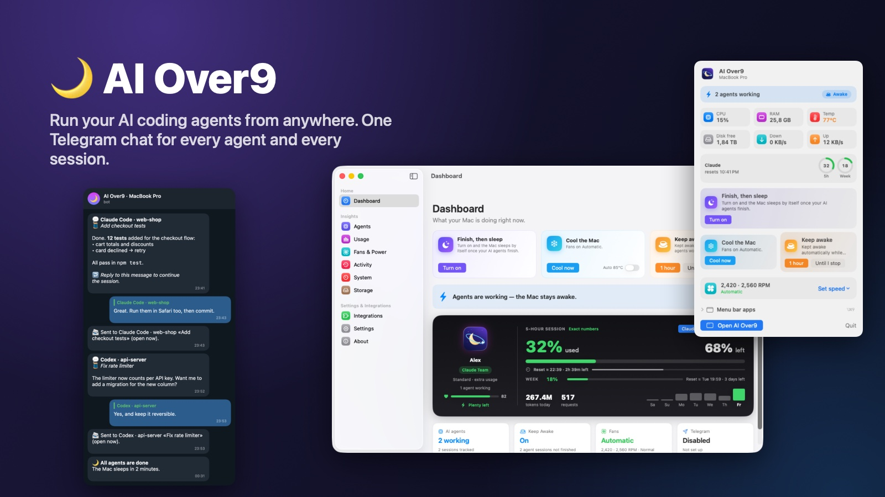
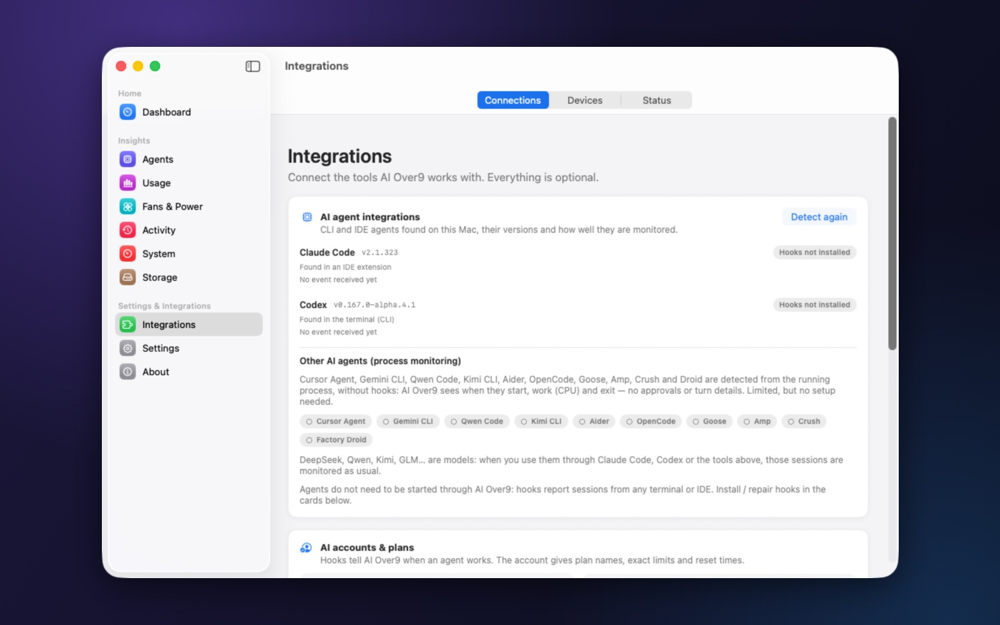
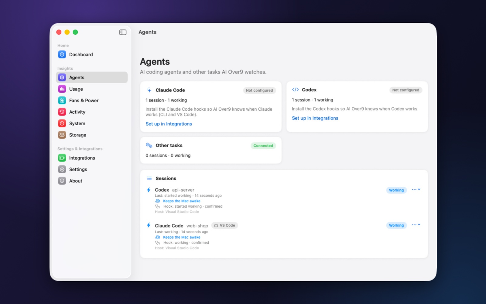
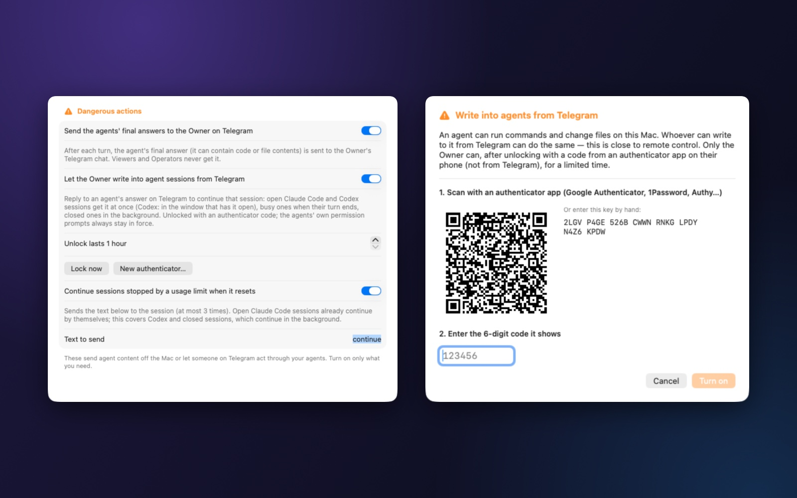
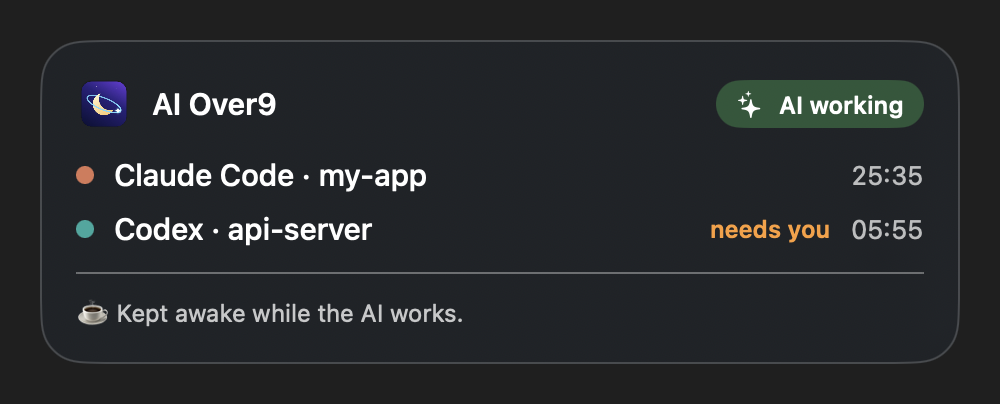
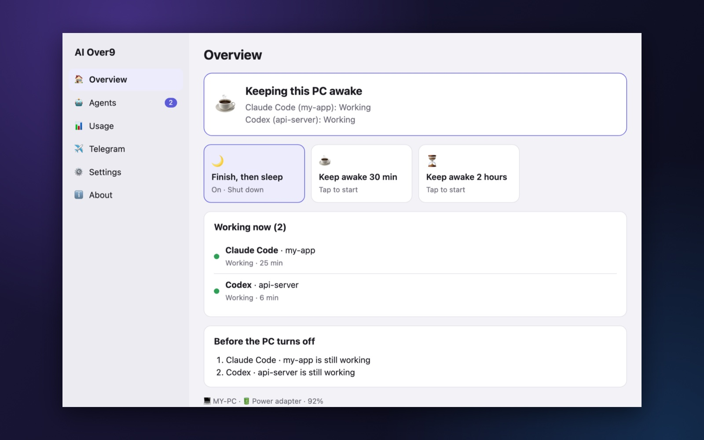

  

<h3 align="center">Run your AI coding agents from anywhere. Your computer works — and rests.</h3>

  AI Over9 watches every Claude Code and Codex session on your computer, brings their answers to your phone, 
  lets you reply to any of them from Telegram, keeps the computer awake while they work and puts it to sleep when they are done.

  <a href="https://github.com/denygame/ai-over9/releases/latest"><b>⬇️ Download the latest release</b></a>
  &nbsp;·&nbsp; <a href="https://denygame.github.io/ai-over9/">🌐 Website</a>
  &nbsp;·&nbsp; <a href="README_VI.md">🇻🇳 Vietnamese</a>
  &nbsp;·&nbsp; <a href="docs/telegram.md">📖 Guides</a>

  <b>macOS</b> 14 or later · Apple silicon &nbsp;|&nbsp; <b>Windows</b> 10 / 11 · x64, ARM64 &nbsp;|&nbsp; <b>Linux</b> x64 <i>(Windows and Linux: preview)</i>

---

## What it does

AI agents now work for hours, in several sessions, in several projects at once. AI Over9 is the control room for that:

| | |
|---|---|
| 👀 **See every agent and session** | Claude Code (terminal, VS Code, desktop app) and Codex (CLI, VS Code, ChatGPT app) report through their official hooks: working, waiting for your approval, finished, limited, interrupted. Ten more CLI agents are detected from their process. |
| 💬 **Talk to them from your phone** | Each agent's final answer arrives on Telegram — formatted, with the project and the session's title. **Reply to it and that session continues.** Many agents, many sessions, one chat. |
| ☕ **Keep the computer awake — only while needed** | Awake while an agent works, free to sleep when nothing does. The display can still turn off. |
| 🌙 **Finish, then sleep** | When every agent is done and you are away, a short cancellable countdown and the computer sleeps. |
| 📊 **Know your limits** | 5-hour and weekly plan usage with the real numbers from your Claude and ChatGPT accounts; alerts before you hit them; an optional rule continues stopped sessions when the limit resets. |
| 📱 **Everything from Telegram** | Status, sessions, usage, keep awake, sleep, fans, automations — with roles and confirmation buttons. Never a shell command. |

Everything runs locally. No account, no analytics — only an anonymous daily install count, which you can turn off.

  
   ▶️ 36-second animated demo with sample data — <a href="media/ai-over9-telegram-demo.mp4">watch in full HD</a>. Three sessions, two agents, one chat.

**📖 Guides:** [Connect Claude Code and Codex](docs/connect-agents.md) · [Telegram and chatting with agents](docs/telegram.md) · [Performance: CPU and memory](docs/benchmark.md)

---

## Contents

- [Quick start (10 minutes)](#quick-start-10-minutes)
  - [1. Install](#1-install)
  - [2. Connect Claude Code](#2-connect-claude-code)
  - [3. Connect Codex](#3-connect-codex)
  - [4. Connect Telegram](#4-connect-telegram)
  - [5. Turn on chat with your agents](#5-turn-on-chat-with-your-agents)
  - [6. Try it](#6-try-it)
- [Managing many agents and sessions from Telegram](#managing-many-agents-and-sessions-from-telegram)
- [Telegram commands](#telegram-commands)
- [Features](#features)
- [macOS, Windows and Linux](#macos-windows-and-linux)
- [Installation details](#installation-details)
- [Updates](#updates)
- [Privacy and security](#privacy-and-security)
- [Permissions](#permissions)
- [FAQ and troubleshooting](#faq-and-troubleshooting)
- [Uninstall](#uninstall)
- [License](#license) · [Support](#support)

---

## Quick start (10 minutes)

### 1. Install

1. Download `AIOver9-<version>-macos-arm64.dmg` from the [latest release](https://github.com/denygame/ai-over9/releases/latest), open it and drag **AI Over9** to **Applications**.
2. **First launch only:** the app is signed by its author but not notarized by Apple. Right-click **AI Over9** › **Open** › **Open** (or *System Settings › Privacy & Security › Open Anyway*).
3. The 🌙 icon appears in the menu bar and a short setup assistant opens.

Or with Homebrew: `brew install --cask denygame/tap/ai-over9` (if Homebrew asks you to trust the tap first: `brew trust denygame/tap`, then run the install again).

Windows and Linux: see [Installation details](#installation-details).

### 2. Connect Claude Code

AI Over9 follows Claude Code through its hooks — small entries in `~/.claude/settings.json` that call AI Over9 when something happens. They work for every Claude Code you use: terminal, VS Code and the Claude desktop app.

1. Open **Integrations**. AI Over9 has already found your agents and their versions.
2. Open the **Claude Code** card › **Preview install** — you see exactly what will be added — › **Apply**.
3. Your file is merged and backed up first; only AI Over9's own entries are added (and removed again with *Preview removal*).

  
   Integrations finds your agents and installs their hooks — merged and backed up.

> Moved Claude's folder (`CLAUDE_CONFIG_DIR`)? Pick it in the same card; hooks, limits and token counts follow it.
> Full details: [Connect Claude Code and Codex](docs/connect-agents.md).

The next time you start a prompt, the session appears in **Agents** as *Working*:

  
   Every session appears with its state the moment the agent starts working.

### 3. Connect Codex

1. In **Integrations**, open the **Codex** card › **Codex hooks (recommended)** › **Preview install** › **Apply**. This writes `~/.codex/hooks.json`.
2. **Trust the hooks in Codex — once.** Codex runs a hook only after you approved it; until then it silently skips it and AI Over9 sees nothing.
   - The Codex card shows **"Codex has not trusted AI Over9's hooks"** with a **Review in Terminal…** button: it opens Codex, which shows **Hooks need review**.
   - Choose **Review hooks**, check that they are AI Over9's (`aio-hook --agent codex`), then **Trust all and continue**. Quit Codex (Ctrl+C twice).
   - No button? Run Codex in a terminal and type `/hooks`.
3. **Restart Codex where you use it** so open windows load the trusted hooks: VS Code › *Developer: Reload Window*, or quit and reopen the ChatGPT app.

> Codex asks again whenever a hook changes. If Codex sessions stop appearing, look at the Codex card first.
> Full details and troubleshooting: [Connect Claude Code and Codex](docs/connect-agents.md#codex).

### 4. Connect Telegram

You use your own bot — one bot per computer. It takes two minutes:

1. In Telegram, open [@BotFather](https://t.me/BotFather), send `/newbot` and pick a name. BotFather replies with a **token**.
2. In AI Over9: **Integrations › Telegram**, paste the token and click **Save to Keychain**. The token is stored only in the macOS Keychain — never paste it into a chat.
3. Click **Create pairing code (you become Owner)**, open a private chat with your bot and send what the app shows (e.g. `/pair 7AB6NS2B`). The code works once and expires in a few minutes.
4. Send `/status` to the bot. You now get messages when an agent starts, finishes, needs approval or hits a limit.

Roles, notifications and every command: [Telegram guide](docs/telegram.md).

Other people can be added with **Create code for another person**, as **Viewer** (read only) or **Operator** (everyday actions). Only the **Owner** can change power, fans, users — and talk to agents.

### 5. Turn on chat with your agents

Writing to agents from a phone is powerful: an agent can run commands and change files. So it is off by default, Owner only, and protected by a second factor.

1. **Settings › Dangerous actions › Send the agents' final answers to the Owner on Telegram** — confirm.
2. **Let the Owner write into agent sessions from Telegram** — a setup sheet opens:
   - scan the QR code with an authenticator app (Google Authenticator, 1Password, Authy…);
   - enter the 6-digit code it shows › **Turn on**.

  
   Settings › Dangerous actions, and the one-time authenticator setup.

3. Choose how long one unlock lasts (1 hour by default, up to 24). **Lock now** ends it at once; **New authenticator…** replaces the key.

### 6. Try it

1. Give an agent a task in Claude Code or Codex.
2. When it finishes, its answer arrives on Telegram, with the project and the session title.
3. **Reply** to that message. The first time, the bot asks for `/unlock` and the current code from your authenticator app: send `/unlock 123456`.
4. Reply again — the bot confirms where your message went, and the agent's next answer arrives a moment later.

---

## Managing many agents and sessions from Telegram

Full guide: [Telegram › Chatting with your agents](docs/telegram.md#chatting-with-your-agents).

**Where does my message go?**

- **Reply to an answer** → into the session that wrote it. This is the reliable way with several sessions: every answer names its agent, project and session title (🧵).
- **A plain message** (no reply) → into the session of the latest answer you received.
- An answer the bot can no longer place (very old) is refused with a note — your message never lands in another session by mistake.

**What happens then** — the bot always tells you:

| Session | Your message |
|---|---|
| **Claude Code**, open (terminal, VS Code, desktop app) | 📨 Delivered **at once**, even mid-turn. The agent starts its answer with `📱 Telegram: …` so you also see your message in the session window. |
| **Codex**, open in VS Code or the ChatGPT app, idle | 📨 Delivered **at once** through that window — it shows there like a typed message. |
| **Codex**, busy with a turn | ⏳ Handed over the moment the current turn ends. |
| **Closed session** (window closed, terminal ended) | 🔄 **Continued in the background** (`claude --resume` / `codex exec resume`); the answer comes back to Telegram, and the session shows the turn when you reopen it. |

**Answers on your phone** keep their formatting: bold, lists, links, code blocks, and tables (as aligned columns). Very long answers are shortened, with a note.

**Approve from your phone** *(optional, Settings › Dangerous actions)*: while you are away, permission prompts of
Claude Code and Codex arrive with **Allow / Deny**. No answer → the agent asks on the computer; nothing is ever approved
by itself.

**Photos and files** *(optional, Settings › Dangerous actions)*: send a screenshot or a document with your request as
the caption; it is saved in the session's project (kept out of git) and the agent opens it.

**Session buttons and new work:** `/sessions` numbers the sessions with buttons to choose where your next message goes
(also `/sessions 3`), show its project's uncommitted changes, or stop a Codex turn. `/new <folder> <task>` starts a new
session in a folder inside the parent folder you chose — created if needed, never outside it.

**Continue after a usage limit** *(optional rule, Settings › Dangerous actions)*: a session stopped by a usage limit gets your text (default `continue`) once the limit resets — at most 3 times per session. The computer stays awake until then, so *Finish, then sleep* waits for the session instead of sleeping through the reset. Good for long tasks that run overnight.

**Safety, by design:**

- Owner only. Viewers and Operators never receive answers and cannot write to agents.
- Writing needs an **unlock with a code from your authenticator app** — not from Telegram. A stolen Telegram account alone cannot drive your agents. Wrong codes are rate-limited, and the code is never kept in the message history.
- The agents' own permission rules always apply. Nothing is bypassed, and the bot never runs a command itself.
- `/lock` (or **Lock now** in the app) closes it at once.

---

## Telegram commands

| Command | What it does |
|---|---|
| `/status`, `/menu` | Overview with quick buttons |
| `/why` | Why the computer is awake, what still blocks sleep |
| `/agents`, `/sessions` | Agents and their sessions |
| `/usage`, `/reset` | Plan limits, reset times, token usage |
| `/awake`, `/awake 30`, `/awake off` | Keep-awake status, keep awake N more minutes, stop |
| `/sleep`, `/cancel` | Request sleep (safety checks, countdown), cancel it |
| `/unlock <code>`, `/lock` | Open / close writing to agents (Owner, authenticator code) |
| `/new <folder> [claude/codex] <task>` | Start a new session in a folder inside the allowed parent (Owner, unlocked) |
| `/fans`, `/fans auto`, `/fans cool`, `/fans set <1/2/all> <rpm>` | Fan status, Automatic, cool now, constant speed (Owner, if allowed) |
| `/mission`, `/missions`, `/report` | Tonight's work and its report |
| `/battery`, `/power`, `/profile <name>` | Battery, power modes |
| `/schedule`, `/automation`, `/run <name>` | Schedules and allowed automations |
| `/devices`, `/device <name> on/off` | Smart devices |
| `/users`, `/lang en` · `/lang vi`, `/help` | Paired people, message language, help |

Every risky action asks for a confirmation button, and permissions are checked again when you press it. Commands sent while the computer slept are not replayed one by one — you get a short summary instead.

---

## Features

### Agent monitoring

- **Claude Code** and **Codex** through their official hooks, with states: working, waiting for approval, idle, finished, limited, interrupted. Background tasks keep a session *working* until the last one ends — one "finished" message, not five.
- **Other agents detected automatically** from their process: Cursor Agent, Gemini CLI, Qwen Code, Kimi CLI, Aider, OpenCode, Goose, Amp, Crush, Factory Droid (start, working, exit).
- **"Why is my Mac awake?"** in plain words: which agents, which other apps, what still blocks sleep.
- **Missions:** a night's work is grouped when you turn on *Finish, then sleep*, with a report at the end.

### Quick actions

| | | |
|---|---|---|
| 🌙 | **Finish, then sleep** | Waits until every agent is done, nothing waits for approval and you have been away a few minutes; then a 2-minute cancellable countdown (in the menu bar and on Telegram) and sleep. New work cancels it. |
| ❄️ | **Cool the Mac** | Faster fans until the CPU is cool, then back to Automatic. Optional auto-cool at 85 °C. |
| ☕ | **Keep awake** | One hour, or until you stop it. |

### Usage limits

- **Exact numbers** (optional): 5-hour and weekly percentages and reset times from your Claude and ChatGPT accounts, using the sign-in those tools already stored. Tokens stay in memory for the request only. Percentages are shown only when they come from the provider — never guessed.
- **Token usage** from local session files: today, 7 and 30 days, by agent, model and project (numbers only).
- **Alerts** when a limit is almost used, reached, or available again.

### Notifications

- Telegram, Notification Center, and small messages under the menu bar icon.
- **Only when I am away:** turn messages wait until you have left the computer for 2 minutes. Approvals and limits always come through.
- Quiet hours, minimum severity, per-kind rules.

### On the Mac

- **Lock screen status:** while the Mac is locked, a card under the clock shows working agents, approvals needed and the sleep countdown.
- **Menu bar apps:** when the menu bar is full or behind the notch, the panel lists every app's icon and opens any of them. **⌥⌘9** (changeable) opens the panel from anywhere.
- **Fans:** read every fan; with a small helper (installed once with your password) set constant speeds, cool now, auto-cool and saved profiles. Fans return to Automatic on quit, on high temperature and if the app stops responding.
- **Claude Remote Control:** one switch for every new Claude Code session, to continue it from claude.ai or the Claude app.
- **Automations, schedules, power modes** (Advanced mode), **Home Assistant and HTTP devices**, **system and storage** views, **backup and restore**.

  
   While the Mac is locked: who is working, and who needs you.

---

## macOS, Windows and Linux

Every version is published for all three at once. Windows and Linux share one app (preview).

| | macOS | Windows / Linux (preview) |
|---|---|---|
| Claude Code and Codex hooks | ✅ | ✅ |
| Chat with agents from Telegram, continue after a limit | ✅ | ✅ ¹ |
| Keep awake, Finish then sleep | ✅ sleep | ✅ shut down, hibernate or sleep |
| Usage limits and token totals | ✅ | ✅ |
| Telegram remote and notifications | ✅ full command set | ✅ core commands |
| Other agents from the process list | ✅ | — |
| Fans, lock screen card, menu bar apps, automations, devices | ✅ | — |
| Signed automatic updates | ✅ | ✅ |

¹ Not yet verified on real Windows / Linux machines: a message for an open session may wait until its current turn ends.

  
   AI Over9 for Windows (preview).

---

## Installation details

**macOS** — see [Quick start](#1-install). Each release has a `.sha256` file: `shasum -a 256 -c AIOver9-<version>-macos-arm64.dmg.sha256`.

**Windows**

1. Download `AIOver9-<version>-windows-x64-setup.exe` (most PCs) or `…-windows-arm64-setup.exe` (Windows on ARM). *Settings › System › About › System type* tells which.
2. Run it — installs for your user, no administrator rights. If SmartScreen warns (not code-signed yet): **More info › Run anyway**.
3. Connect agents in **Agents**, Telegram in **Telegram**, dangerous actions in **Settings**. The bot token lives in Windows Credential Manager. Data: `%APPDATA%\AIOver9`.
4. *Finish, then sleep* shuts the PC down by default (Modern Standby sleep often keeps draining the battery); hibernate or sleep are options. Shutdown is never forced.

**Linux**

- **AppImage** (any distribution, updates itself): `chmod +x`, keep it in one place (e.g. `~/Applications`), run it. After moving it, use *Agents › Repair*.
- **.deb**: `sudo apt install ./AIOver9-<version>-linux-amd64.deb`.
- Tray icon needs AppIndicator (GNOME: the *AppIndicator* extension). Token in the system keyring. Idle detection on GNOME and KDE. Data: `~/.local/share/AIOver9`.

---

## Updates

- Checked every 4 hours or from **Settings › Updates**; a new version shows at the top of the menu bar panel. One click installs it and the app restarts.
- Every update is verified before installing (author's signature, same certificate). Settings, pairing, Keychain items and the fan helper are kept.

---

## Privacy and security

- **Local first.** Sessions, history and usage numbers stay in `~/Library/Application Support/AIOver9`.
- **No account, no analytics.** Network only for what you turn on: your Telegram bot, *Exact numbers* (your Claude / ChatGPT usage), your Home Assistant / HTTP devices, update checks (GitHub).
- **Anonymous install count** (Settings › General, on by default, can be turned off): once a day the app sends a random install id made on your computer, the app version, the system version and the chip type — nothing else (no names, projects, agents or usage). It shows how many computers use AI Over9 and which versions still need support.
- **Secrets** (bot token, authenticator key, device tokens) live only in the Keychain — never in files, logs or backups.
- **Agent content** leaves the computer only if you turn on *Dangerous actions*, and then only to your own Telegram chat, for the Owner. Otherwise only token counts are read from session files. Project names in messages are optional.
- **Telegram:** paired people only, roles, confirmations, an authenticator code to write to agents; no shell commands, ever.
- **Agent configuration files** are merged and backed up; only AI Over9's own entries are added or removed.

---

## Permissions

| macOS may ask for | Why | When |
|---|---|---|
| Notifications | Alerts on this Mac | First launch |
| Administrator password | Installing the fan helper | Only if you install it |
| Accessibility | Opening other apps' menu bar icons; screen-lock shortcut | Only when you use *Menu bar apps* or that automation |
| Automation (System Events) | Graceful shutdown, screen lock | Only if you enable those automations |
| Documents / Desktop / Downloads | Measuring build folders | Only when you scan storage there |

---

## FAQ and troubleshooting

**Codex sessions never appear (no status, no messages).**
Codex has not trusted the hooks. Open **Integrations › Codex** and use **Review in Terminal…** ([step 3](#3-connect-codex)), then restart Codex where you use it.

**I replied to a Codex answer and the bot says "⏳ when its current turn ends".**
That session is working right now; your message goes in when the turn ends. If it is open in another Codex window that does not answer, close that window: the message then continues the session in the background.

**The bot asks for `/unlock` again.**
The unlock period ended (Settings › Dangerous actions › *Unlock lasts*), you sent `/lock`, or the app restarted. Send `/unlock` with a fresh code.

**No Telegram message when an agent finished.**
*Settings › Notifications › Only when I am away* holds turn messages while you use the computer. Answers (💬) need *Dangerous actions › Send the agents' final answers*.

**The Mac did not sleep after the agents finished.**
It waits until you have been away a few minutes and nothing is still running. The 🌙 tile and `/why` say what it waits for.

**Usage percentages are missing.**
Turn on **Exact numbers** (Usage, or the green link on the Dashboard). Without it only token counts are shown — percentages are never estimated.

**The menu bar icon is missing.** The menu bar is full or behind the notch: press ⌥⌘9, or open AI Over9 from Spotlight.

**macOS says the app cannot be opened.** See [Install](#1-install), step 2 — needed once.

**Windows: SmartScreen blocks the installer.** **More info › Run anyway** (not code-signed yet).

**Linux: no tray icon.** Enable the *AppIndicator and KStatusNotifierItem Support* extension (GNOME).

---

## Uninstall

1. Optional, in the app: remove the agent hooks (Integrations › Claude Code / Codex › Preview removal), the fan helper (Fans & Power) and Remote Control.
2. Quit AI Over9 from the menu bar and delete it from Applications.
3. Optional: `rm -rf ~/Library/Application\ Support/AIOver9`. Keychain items are under `dev.huynt.aiover9`.

---

## License

- Copyright © 2026 HuyNT. All rights reserved.
- Provided "as is", without warranty. Automations that sleep or shut down the computer, control fans or devices, or let you write to agents from Telegram are used at your own risk.
- Third-party software: [Sparkle](https://sparkle-project.org) (MIT) on macOS; [Tauri](https://tauri.app) and open-source Rust crates (MIT / Apache-2.0) on Windows and Linux. Native fan control was written for AI Over9, informed by the MIT-licensed [AutoFansMac](https://github.com/garyhooi/AutoFansMac), [MacFanControl](https://github.com/raminsharifi/MacFanControl) and [macsfan](https://github.com/matejrondzik/macsfan).

## Support

AI Over9 is free, with no ads. If it makes your nights easier, you can buy the author a coffee from **About** in the app, or from abroad via [PayPal](https://paypal.me/HuyNT2202) — entirely optional.

Questions, ideas or bugs: open an [issue](https://github.com/denygame/ai-over9/issues).
