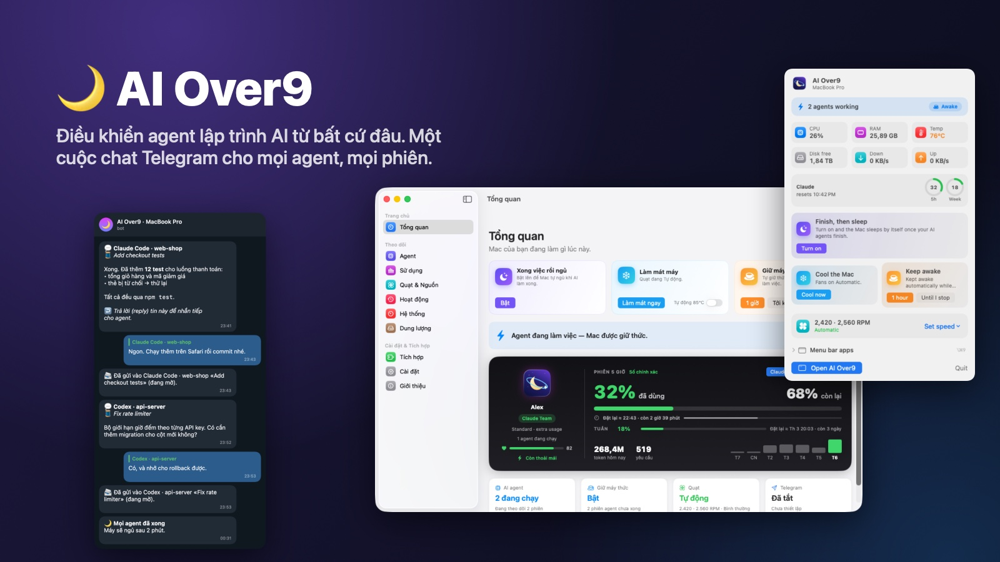
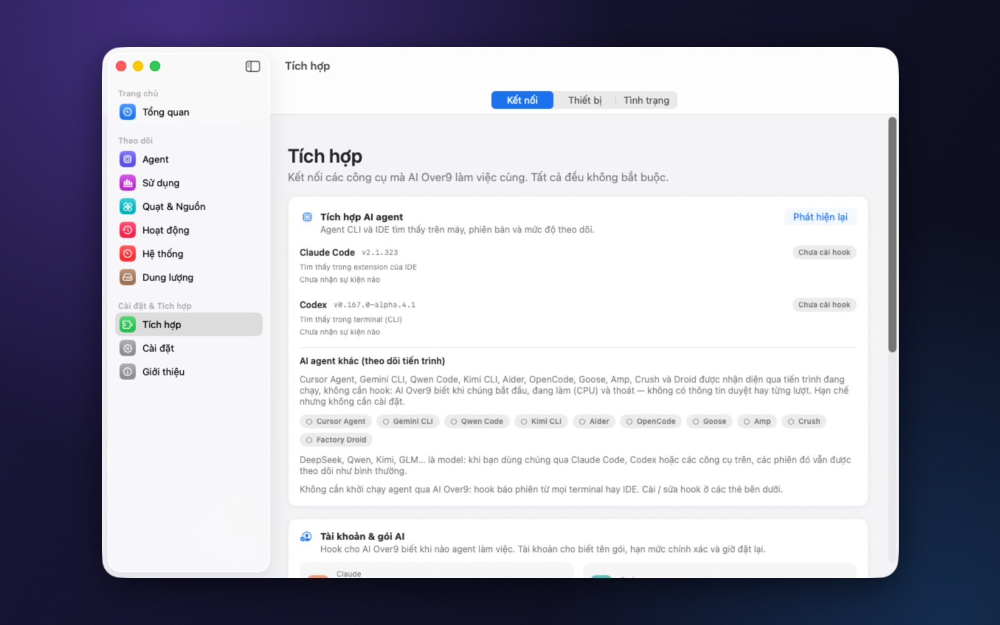
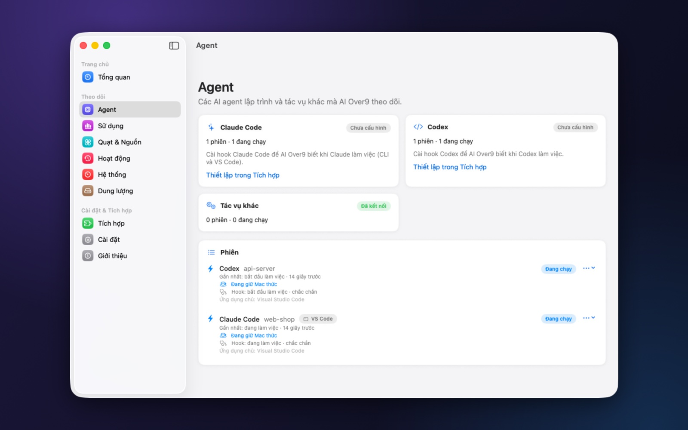
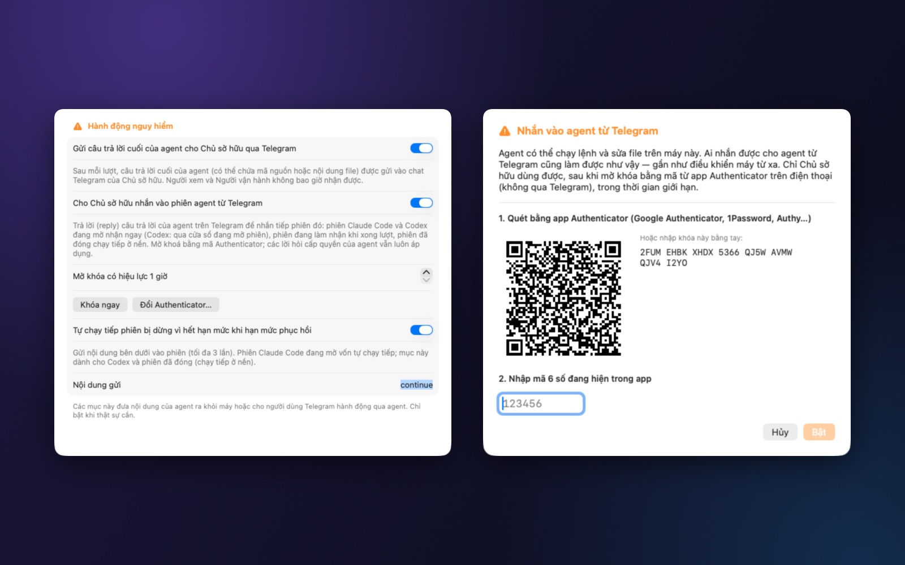
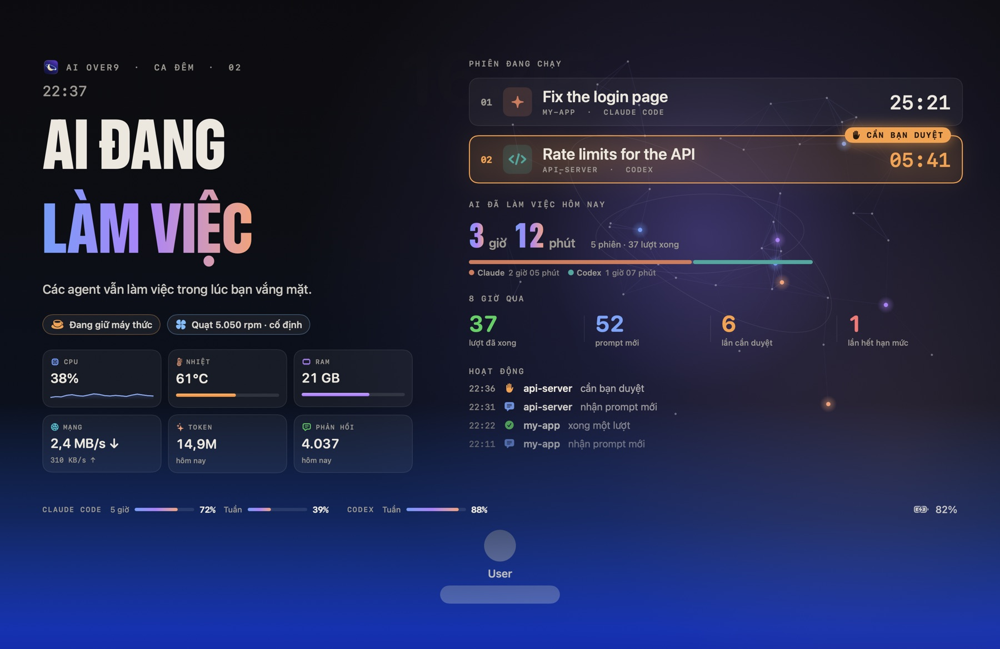
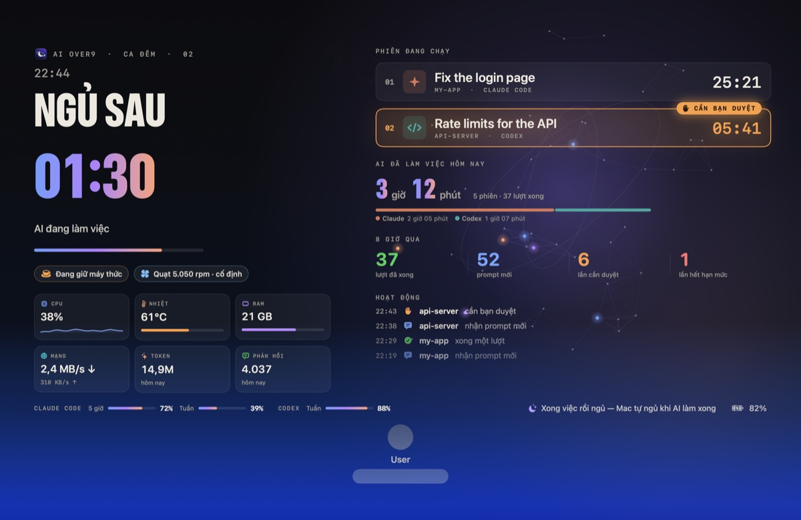
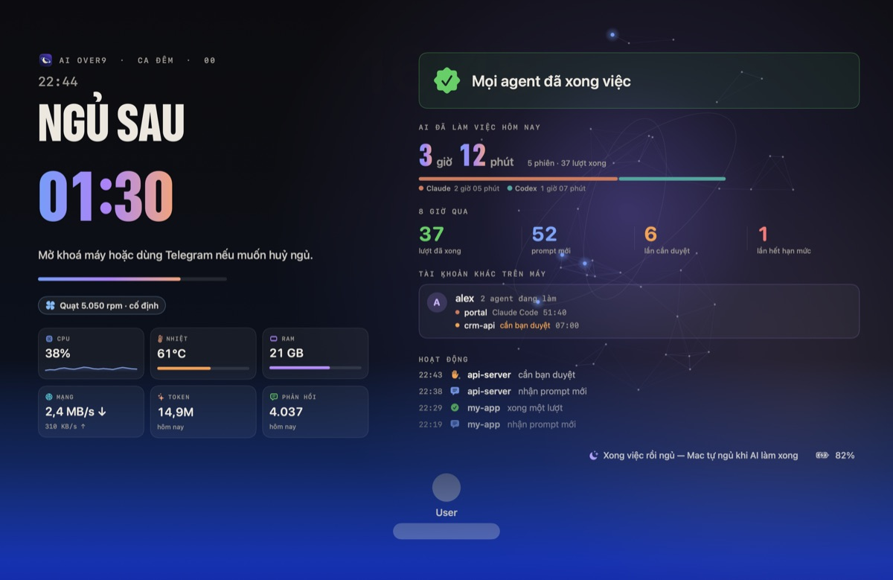
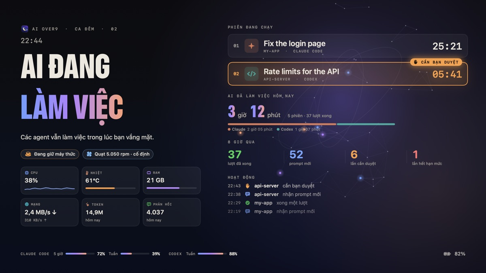
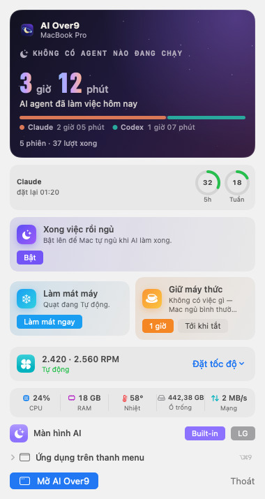
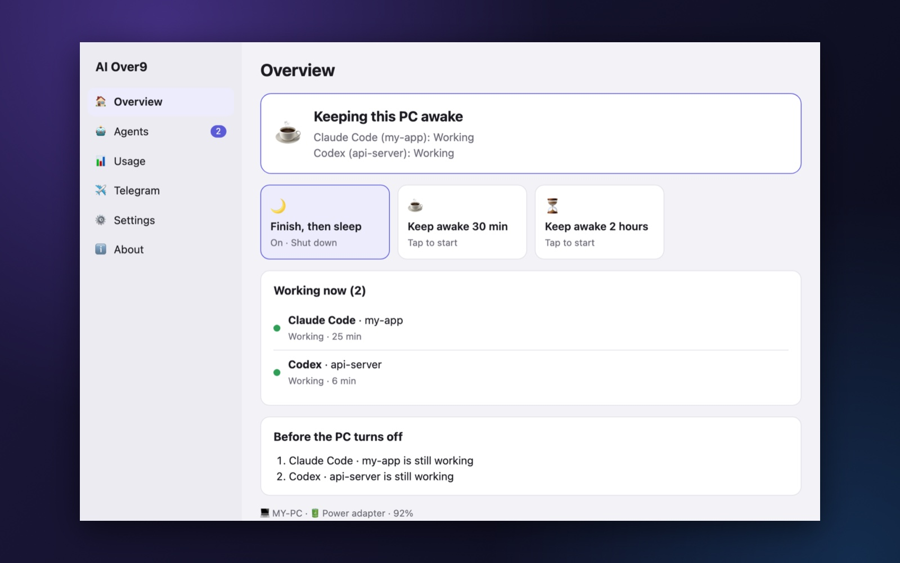

  

<h3 align="center">Điều khiển các agent lập trình AI từ bất cứ đâu. Máy tính làm việc — và được nghỉ.</h3>

  AI Over9 theo dõi mọi phiên Claude Code và Codex trên máy, đưa câu trả lời của chúng lên điện thoại, 
  cho bạn trả lời từng phiên ngay trên Telegram, giữ máy thức khi agent làm việc và cho máy ngủ khi tất cả đã xong.

  <a href="https://github.com/denygame/ai-over9/releases/latest"><b>⬇️ Tải bản mới nhất</b></a>
  &nbsp;·&nbsp; <a href="https://denygame.github.io/ai-over9/vi/">🌐 Website</a>
  &nbsp;·&nbsp; <a href="README.md">🇬🇧 English</a>
  &nbsp;·&nbsp; <a href="docs/telegram.vi.md">📖 Tài liệu</a>

  <b>macOS</b> 14 trở lên · Apple silicon &nbsp;|&nbsp; <b>Windows</b> 10 / 11 · x64, ARM64 &nbsp;|&nbsp; <b>Linux</b> x64 <i>(Windows và Linux: bản xem trước)</i>

---

## AI Over9 làm được gì

Agent AI giờ làm việc hàng giờ liền, nhiều phiên, nhiều dự án cùng lúc. AI Over9 là phòng điều khiển cho tất cả:

| | |
|---|---|
| 👀 **Thấy mọi agent, mọi phiên** | Claude Code (terminal, VS Code, app desktop) và Codex (CLI, VS Code, ChatGPT app) báo trạng thái qua hook chính thức: đang làm, chờ bạn duyệt, đã xong, hết hạn mức, bị ngắt. Thêm mười agent CLI khác được nhận diện qua tiến trình. |
| 💬 **Nói chuyện với agent qua điện thoại** | Câu trả lời cuối của từng agent đến Telegram — giữ định dạng, kèm dự án và tiêu đề phiên. **Reply là phiên đó làm tiếp.** Nhiều agent, nhiều phiên, một cuộc chat. |
| ☕ **Giữ máy thức — đúng lúc cần** | Thức khi có agent làm việc, được ngủ khi không còn việc. Màn hình vẫn có thể tắt. |
| 🌙 **Xong việc rồi ngủ** | Khi mọi agent đã xong và bạn không dùng máy: đếm ngược ngắn (huỷ được) rồi máy ngủ. |
| 📊 **Nắm rõ hạn mức** | Hạn mức 5 giờ và theo tuần bằng số thật từ tài khoản Claude và ChatGPT; cảnh báo trước khi chạm ngưỡng; tuỳ chọn tự chạy tiếp phiên bị dừng khi hạn mức phục hồi. |
| 📱 **Mọi thứ qua Telegram** | Trạng thái, phiên, hạn mức, giữ thức, cho ngủ, quạt, tự động hoá — có phân quyền và nút xác nhận. Không bao giờ chạy lệnh shell. |

Mọi thứ chạy trên máy bạn. Không tài khoản, không analytics — chỉ có lượt đếm cài đặt ẩn danh mỗi ngày (xem [Quyền riêng tư](#quyền-riêng-tư-và-bảo-mật)).

  
   ▶️ Demo động 36 giây với dữ liệu mẫu (tiếng Anh) — <a href="media/ai-over9-telegram-demo.mp4">xem bản Full HD</a>. Ba phiên, hai agent, một cuộc chat.

**📖 Tài liệu:** [Kết nối Claude Code và Codex](docs/connect-agents.vi.md) · [Telegram và chat với agent](docs/telegram.vi.md) · [Hiệu năng: CPU và bộ nhớ](docs/benchmark.vi.md)

---

## Mục lục

- [Bắt đầu nhanh (10 phút)](#bắt-đầu-nhanh-10-phút)
  - [1. Cài đặt](#1-cài-đặt)
  - [2. Kết nối Claude Code](#2-kết-nối-claude-code)
  - [3. Kết nối Codex](#3-kết-nối-codex)
  - [4. Kết nối Telegram](#4-kết-nối-telegram)
  - [5. Bật chat với agent](#5-bật-chat-với-agent)
  - [6. Dùng thử](#6-dùng-thử)
- [Quản lý nhiều agent, nhiều phiên qua Telegram](#quản-lý-nhiều-agent-nhiều-phiên-qua-telegram)
- [Lệnh Telegram](#lệnh-telegram)
- [Tính năng](#tính-năng)
- [Màn hình khoá](#màn-hình-khoá)
- [macOS, Windows và Linux](#macos-windows-và-linux)
- [Cài đặt chi tiết](#cài-đặt-chi-tiết)
- [Cập nhật](#cập-nhật)
- [Quyền riêng tư và bảo mật](#quyền-riêng-tư-và-bảo-mật)
- [Quyền hệ thống](#quyền-hệ-thống)
- [Câu hỏi thường gặp](#câu-hỏi-thường-gặp)
- [Gỡ cài đặt](#gỡ-cài-đặt)
- [Giấy phép](#giấy-phép) · [Ủng hộ](#ủng-hộ)

---

## Bắt đầu nhanh (10 phút)

### 1. Cài đặt

1. Tải `AIOver9-<version>-macos-arm64.dmg` ở [bản phát hành mới nhất](https://github.com/denygame/ai-over9/releases/latest), mở ra và kéo **AI Over9** vào **Applications**.
2. **Chỉ lần mở đầu tiên:** app được tác giả ký nhưng chưa được Apple notarize. Nhấp phải **AI Over9** › **Open** › **Open** (hoặc *System Settings › Privacy & Security › Open Anyway*).
3. Biểu tượng 🌙 xuất hiện trên thanh menu và trợ lý thiết lập mở ra.

Hoặc dùng Homebrew: `brew install --cask denygame/tap/ai-over9` (nếu Homebrew yêu cầu tin cậy tap trước: chạy `brew trust denygame/tap` rồi cài lại).

Windows và Linux: xem [Cài đặt chi tiết](#cài-đặt-chi-tiết).

### 2. Kết nối Claude Code

AI Over9 theo dõi Claude Code qua hook — vài dòng nhỏ trong `~/.claude/settings.json` gọi AI Over9 khi có sự kiện. Hook áp dụng cho mọi Claude Code bạn dùng: terminal, VS Code và app Claude desktop.

1. Mở **Tích hợp**. AI Over9 đã tự tìm thấy các agent trên máy và phiên bản của chúng.
2. Mở thẻ **Claude Code** › **Xem trước khi cài** — bạn thấy chính xác những gì sẽ được thêm — › **Áp dụng**.
3. File của bạn được gộp và sao lưu trước; chỉ các dòng của AI Over9 được thêm vào (và gỡ ra bằng *Xem trước khi gỡ*).

  
   Tích hợp tự tìm các agent và cài hook — gộp và sao lưu trước.

> Đã chuyển thư mục của Claude (`CLAUDE_CONFIG_DIR`)? Chọn thư mục đó ngay trong thẻ; hook, hạn mức và số token sẽ theo đúng thư mục.
> Chi tiết: [Kết nối Claude Code và Codex](docs/connect-agents.vi.md).

Lần tới bạn gửi prompt, phiên sẽ hiện trong **Agent** với trạng thái *Đang làm*:

  
   Mỗi phiên hiện ra cùng trạng thái ngay khi agent bắt đầu làm việc.

### 3. Kết nối Codex

1. Trong **Tích hợp**, mở thẻ **Codex** › **Codex hooks (khuyến nghị)** › **Xem trước khi cài** › **Áp dụng**. Bước này ghi `~/.codex/hooks.json`.
2. **Duyệt hook trong Codex — một lần.** Codex chỉ chạy hook sau khi bạn duyệt; trước đó nó lặng lẽ bỏ qua và AI Over9 không thấy gì.
   - Thẻ Codex hiện **"Codex chưa duyệt hook của AI Over9"** kèm nút **Duyệt trong Terminal…**: nút này mở Codex, Codex hiện màn hình **Hooks need review**.
   - Chọn **Review hooks**, kiểm tra đó là hook của AI Over9 (`aio-hook --agent codex`), rồi **Trust all and continue**. Thoát Codex (Ctrl+C hai lần).
   - Không thấy nút? Chạy Codex trong terminal và gõ `/hooks`.
3. **Khởi động lại Codex ở nơi bạn dùng** để các cửa sổ đang mở nạp hook đã duyệt: VS Code › *Developer: Reload Window*, hoặc thoát hẳn rồi mở lại ChatGPT app.

> Codex hỏi lại mỗi khi hook thay đổi. Nếu phiên Codex không còn hiện, hãy xem thẻ Codex trước tiên.
> Chi tiết và xử lý sự cố: [Kết nối Claude Code và Codex](docs/connect-agents.vi.md#codex).

### 4. Kết nối Telegram

Bạn dùng bot của riêng mình — mỗi máy một bot. Mất khoảng hai phút:

1. Trên Telegram, mở [@BotFather](https://t.me/BotFather), gửi `/newbot` và đặt tên. BotFather trả về một **token**.
2. Trong AI Over9: **Tích hợp › Telegram**, dán token và bấm **Lưu vào Keychain**. Token chỉ nằm trong Keychain của macOS — đừng bao giờ gửi token vào cuộc chat nào.
3. Bấm **Tạo mã ghép nối (bạn là Chủ sở hữu)**, mở chat riêng với bot và gửi nội dung app hiển thị (ví dụ `/pair 7AB6NS2B`). Mã chỉ dùng một lần và hết hạn sau vài phút.
4. Gửi `/status` cho bot. Từ giờ bạn nhận tin khi agent bắt đầu, xong việc, cần duyệt hoặc chạm hạn mức.

Vai trò, thông báo và mọi lệnh: [Hướng dẫn Telegram](docs/telegram.vi.md).

Thêm người khác bằng **Tạo mã cho người khác**, với vai trò **Người xem** (chỉ xem) hoặc **Người vận hành** (thao tác thường ngày). Chỉ **Chủ sở hữu** mới đổi được nguồn, quạt, người dùng — và nhắn cho agent.

### 5. Bật chat với agent

Nhắn cho agent từ điện thoại là một quyền lớn: agent có thể chạy lệnh và sửa file. Vì vậy tính năng này mặc định tắt, chỉ Chủ sở hữu dùng được và có thêm lớp xác thực thứ hai.

1. **Cài đặt › Hành động nguy hiểm › Gửi câu trả lời cuối của agent cho Chủ sở hữu qua Telegram** — xác nhận.
2. **Cho Chủ sở hữu nhắn vào phiên agent từ Telegram** — một bảng thiết lập mở ra:
   - quét mã QR bằng app Authenticator (Google Authenticator, 1Password, Authy…);
   - nhập mã 6 số app hiển thị › **Bật**.

  
   Cài đặt › Hành động nguy hiểm, và bước thiết lập Authenticator một lần.

3. Chọn thời gian một lần mở khoá (mặc định 1 giờ, tối đa 24 giờ). **Khoá ngay** để khoá lập tức; **Đổi Authenticator…** để thay khoá mới.

### 6. Dùng thử

1. Giao một việc cho agent trong Claude Code hoặc Codex.
2. Khi agent xong, câu trả lời đến Telegram, kèm dự án và tiêu đề phiên.
3. **Reply** tin đó. Lần đầu, bot yêu cầu `/unlock` với mã hiện tại trong app Authenticator: gửi `/unlock 123456`.
4. Reply lại — bot báo tin của bạn đã đi đâu, và vài giây sau câu trả lời tiếp theo của agent đến.

---

## Quản lý nhiều agent, nhiều phiên qua Telegram

Hướng dẫn đầy đủ: [Telegram › Chat với agent](docs/telegram.vi.md#chat-với-agent).

**Tin của tôi đi vào phiên nào?**

- **Reply một câu trả lời** → vào đúng phiên đã viết câu đó. Đây là cách chắc chắn nhất khi có nhiều phiên: mỗi câu trả lời đều ghi agent, dự án và tiêu đề phiên (🧵).
- **Nhắn thường** (không reply) → vào phiên của câu trả lời gần nhất bạn nhận được.
- Reply một câu trả lời bot không còn tra được (quá cũ) thì bị từ chối kèm lời giải thích — tin của bạn không bao giờ vào nhầm phiên.

**Sau đó điều gì xảy ra** — bot luôn báo cho bạn:

| Phiên | Tin của bạn |
|---|---|
| **Claude Code** đang mở (terminal, VS Code, app desktop) | 📨 Vào **ngay**, kể cả khi agent đang làm dở. Agent mở đầu câu trả lời bằng dòng `📱 Telegram: …` nên bạn cũng thấy tin của mình trong cửa sổ phiên. |
| **Codex** đang mở trong VS Code hoặc ChatGPT app, đang rảnh | 📨 Vào **ngay** qua chính cửa sổ đó — hiện như tin bạn tự gõ. |
| **Codex** đang làm một lượt | ⏳ Được đưa vào ngay khi lượt hiện tại kết thúc. |
| **Phiên đã đóng** (đã đóng cửa sổ, đã thoát terminal) | 🔄 **Chạy tiếp ở nền** (`claude --resume` / `codex exec resume`); câu trả lời gửi về Telegram, mở lại phiên là thấy lượt đó. |

**Câu trả lời trên điện thoại** giữ nguyên định dạng: chữ đậm, danh sách, link, khối code, và bảng (hiển thị thành các cột thẳng hàng). Câu trả lời quá dài được rút gọn, có ghi chú.

**Duyệt từ điện thoại** *(tuỳ chọn, Cài đặt › Hành động nguy hiểm)*: yêu cầu cấp quyền của Claude Code và Codex được gửi kèm
nút **Cho phép / Từ chối** — cả khi bạn đang ngồi ở máy (khi đó chỉ chờ điện thoại một lúc ngắn, mặc định 2 phút, rồi
agent hỏi trên máy). Không có trả lời → agent hỏi trên máy; không bao giờ tự cho phép.

**Chat nhanh** *(tuỳ chọn, macOS)*: `/ask <câu hỏi>` hỏi model nhẹ (ChatGPT, Claude, Gemini, OpenRouter, DeepSeek, Ollama…); `/ask done` chuyển cuộc chat thành việc cần làm, một nút giao cho phiên agent — hạn mức của agent dành cho việc làm.

**Tin nhắn thoại** *(tuỳ chọn, macOS)*: nói yêu cầu trên Telegram; app chuyển thành chữ ngay trên máy (âm thanh không rời khỏi máy) rồi gửi vào phiên.

**Ảnh và file** *(tuỳ chọn, Cài đặt › Hành động nguy hiểm)*: gửi ảnh chụp màn hình hay tài liệu, ghi yêu cầu ở phần chú
thích; file được lưu trong dự án của phiên (không lẫn vào git) và agent tự mở ra xem.

**Nút theo phiên và giao việc mới:** `/current_sessions` (chỉ phiên đang mở), `/sessions` (tất cả, kể cả hội thoại cũ
trong lịch sử Claude Code và Codex, để làm tiếp một phiên đã xong từ nhiều ngày trước) và `/session_project <thư mục>` đánh số các phiên kèm nút để chọn phiên nhận tin tiếp theo (hoặc gõ
`/sessions 3`), xem thay đổi chưa commit của dự án, hoặc dừng lượt của Codex. `/new <thư mục> <việc>` mở phiên mới trong
một thư mục nằm trong thư mục cha bạn đã chọn — chưa có thì tạo, không bao giờ ra ngoài.

**Tiếp tục khi hết hạn mức** *(quy tắc tuỳ chọn, Cài đặt › Hành động nguy hiểm)*: phiên bị dừng vì hết hạn mức sẽ nhận đoạn chữ của bạn (mặc định `continue`) khi hạn mức được làm mới — tối đa 3 lần mỗi phiên. Máy được giữ thức tới lúc đó, nên *Xong việc rồi ngủ* sẽ chờ phiên thay vì ngủ quên qua giờ phục hồi. Hợp cho việc dài chạy qua đêm.

**An toàn ngay từ thiết kế:**

- Chỉ Chủ sở hữu. Người xem và Người vận hành không bao giờ nhận câu trả lời và không nhắn được cho agent.
- Muốn nhắn phải **mở khoá bằng mã từ app Authenticator** — không phải từ Telegram. Chỉ chiếm được tài khoản Telegram thì vẫn không điều khiển được agent. Nhập sai mã nhiều lần sẽ bị chặn tạm thời, và mã không bao giờ được lưu trong lịch sử tin nhắn.
- Quy tắc cấp quyền của agent luôn áp dụng. Không bước nào bị bỏ qua, và bot không bao giờ tự chạy lệnh.
- `/lock` (hoặc **Khoá ngay** trong app) khoá lại tức thì.

---

## Lệnh Telegram

| Lệnh | Tác dụng |
|---|---|
| `/status`, `/menu` | Tổng quan kèm nút bấm nhanh |
| `/why` | Vì sao máy đang thức, còn gì chặn máy ngủ |
| `/agents`, `/current_sessions`, `/sessions`, `/session_project <thư mục>` | Agent; phiên đang mở, tất cả các phiên (cả phiên cũ), các phiên của một dự án |
| `/usage`, `/reset` | Hạn mức gói, giờ làm mới, lượng token |
| `/awake`, `/awake 30`, `/awake off` | Trạng thái giữ thức, giữ thêm N phút, tắt |
| `/sleep`, `/cancel` | Yêu cầu cho máy ngủ (kiểm tra an toàn, đếm ngược), huỷ |
| `/unlock <mã>`, `/lock` | Mở / khoá việc nhắn cho agent (Chủ sở hữu, mã Authenticator) |
| `/testapproval` | Yêu cầu duyệt mẫu, đúng các bước như yêu cầu thật — không có gì chạy (Chủ sở hữu) |
| `/open`, `/lockscreen` | Mở một app trong danh sách đã chọn trên Mac (Vận hành) · khoá màn hình; mở khoá chỉ tại máy (Chủ sở hữu) |
| `/new <thư mục> [claude/codex] <việc>` | Mở phiên mới trong thư mục nằm trong thư mục cha được phép (Chủ sở hữu, đã mở khoá) |
| `/fans`, `/fans auto`, `/fans cool`, `/fans set <1/2/all> <rpm>` | Quạt: trạng thái, Tự động, làm mát ngay, tốc độ cố định (Chủ sở hữu, nếu cho phép) |
| `/mission`, `/missions`, `/report` | Việc của đêm nay và báo cáo |
| `/battery`, `/power`, `/profile <tên>` | Pin, chế độ nguồn |
| `/schedule`, `/automation`, `/run <tên>` | Lịch và tự động hoá được phép |
| `/devices`, `/device <tên> on/off` | Thiết bị thông minh |
| `/users`, `/lang en` · `/lang vi`, `/help` | Người đã ghép nối, ngôn ngữ tin nhắn, trợ giúp |

Mọi thao tác rủi ro đều cần bấm nút xác nhận, và quyền được kiểm tra lại khi bấm. Lệnh gửi trong lúc máy ngủ không bị chạy lại từng cái — bạn nhận một tin tóm tắt thay vào đó.

---

## Tính năng

### Theo dõi agent

- **Claude Code** và **Codex** qua hook chính thức, với các trạng thái: đang làm, chờ duyệt, rảnh, đã xong, hết hạn mức, bị ngắt. Tác vụ chạy nền giữ phiên ở trạng thái *đang làm* tới khi tác vụ cuối kết thúc — một tin "đã xong", không phải năm.
- **Agent khác được nhận diện tự động** qua tiến trình: Cursor Agent, Gemini CLI, Qwen Code, Kimi CLI, Aider, OpenCode, Goose, Amp, Crush, Factory Droid (bắt đầu, đang làm, thoát).
- **"Vì sao Mac đang thức?"** giải thích dễ hiểu: agent nào, app nào khác, còn gì chặn máy ngủ.
- **Nhiệm vụ:** công việc trong đêm được gom lại khi bật *Xong việc rồi ngủ*, có báo cáo khi xong.

### Thao tác nhanh

| | | |
|---|---|---|
| 🌙 | **Xong việc rồi ngủ** | Chờ tới khi mọi agent xong, không còn gì chờ duyệt và bạn đã rời máy vài phút; sau đó đếm ngược 2 phút (huỷ được, hiện trên thanh menu và Telegram) rồi ngủ. Có việc mới là tự huỷ. |
| ❄️ | **Làm mát máy** | Tăng quạt tới khi CPU mát, rồi trả về Tự động. Tuỳ chọn tự làm mát ở 85 °C. |
| ☕ | **Giữ máy thức** | Một giờ, hoặc tới khi bạn tắt. |

### Hạn mức sử dụng

- **Số chính xác** (tuỳ chọn): phần trăm hạn mức 5 giờ và theo tuần, giờ làm mới, lấy từ tài khoản Claude và ChatGPT bằng đăng nhập sẵn có của các công cụ đó. Token chỉ dùng trong bộ nhớ cho đúng yêu cầu đó. Phần trăm chỉ hiện khi đến từ nhà cung cấp — không bao giờ ước đoán.
- **Lượng token** từ file phiên trên máy: hôm nay, 7 và 30 ngày, theo agent, model và dự án (chỉ con số).
- **Cảnh báo** khi sắp hết, đã hết, hoặc hạn mức đã phục hồi.

### Thông báo

- Telegram, Notification Center, và tin nhỏ ngay dưới biểu tượng trên thanh menu.
- **Chỉ khi tôi vắng mặt:** tin về từng lượt chỉ gửi khi bạn đã rời máy 2 phút. Tin cần duyệt và hạn mức luôn được gửi.
- Giờ yên lặng, mức độ tối thiểu, quy tắc theo từng loại.

### Trên Mac

- **Màn hình khoá "ca đêm":** khi Mac khoá và agent đang làm, giao diện toàn màn hình hiện tiêu đề lớn (AI đang làm việc, hoặc đếm ngược tới lúc ngủ), từng phiên với phiên cần bạn được làm nổi bật, hoạt động gần đây (prompt mới, cần duyệt, xong lượt), giữ máy thức và quạt, hạn mức còn lại và pin — trên mọi màn hình, vẫn chừa ô nhập mật khẩu. Hiệu ứng ngắn khi mở và khi có thay đổi, không có gì chuyển động suốt đêm. Kiểu thẻ gọn vẫn chọn được (Cài đặt › Màn hình khoá và màn hình AI).
- **AI đã làm việc hôm nay:** các agent đã làm bao lâu trong ngày — nhiều phiên chạy cùng lúc chỉ tính một lần, thời gian chờ duyệt không tính — chia theo Claude / Codex, ở đầu bảng menu bar, trên màn hình khoá và màn hình AI.
- **Màn hình AI:** cùng giao diện đó trong một cửa sổ trên màn hình bạn chọn, không cần khoá máy — để theo dõi agent từ màn hình phụ: mỗi màn hình một nút trên thanh menu. Bấm Esc để đóng.
- **Nhiều tài khoản macOS trên một máy:** mỗi tài khoản có thể chia sẻ bản tóm tắt việc AI đang làm (agent, dự án, chờ duyệt, đếm ngược ngủ — không bao giờ có prompt hay code) và thấy của các tài khoản khác trên màn hình khoá và màn hình AI. Mặc định tắt. Một tài khoản không bao giờ cho máy ngủ khi agent của tài khoản khác đang chạy.
- **Luôn chạy:** nếu AI Over9 bị kill hoặc gặp lỗi, macOS mở lại sau vài giây (bấm Thoát vẫn thoát). Mỗi phút app kiểm tra hook của agent còn trỏ về app không, nếu bị đổi thì tự trỏ lại.
- **App trên thanh menu:** khi thanh menu đầy hoặc bị tai thỏ che, bảng điều khiển liệt kê biểu tượng của mọi app và mở được từng cái. **⌥⌘9** (đổi được) mở bảng điều khiển từ bất cứ đâu.
- **Quạt:** đọc mọi quạt; với một helper nhỏ (cài một lần bằng mật khẩu quản trị) có thể đặt tốc độ cố định, làm mát ngay, tự làm mát và lưu cấu hình. Quạt tự về Tự động khi thoát app, khi nhiệt độ cao, hoặc khi app không phản hồi.
- **Claude Remote Control:** một công tắc cho mọi phiên Claude Code mới, để làm tiếp từ claude.ai hoặc app Claude.
- **Tự động hoá, lịch, chế độ nguồn** (Chế độ nâng cao), **Home Assistant và thiết bị HTTP**, **hệ thống và dung lượng**, **sao lưu và khôi phục**.

---

## Màn hình khoá

Khoá Mac khi agent đang làm, màn hình chuyển thành một **dashboard ca đêm** — đứng xa vẫn đọc được, đủ dịu để bật suốt đêm.

  

| | |
|---|---|
|  **Xong việc rồi ngủ** — đồng hồ đếm ngược thật lớn trước khi Mac ngủ; mở khoá hoặc dùng Telegram để huỷ. |  **Đã xong hết** — mọi agent đã xong; tài khoản khác trên máy và agent của họ, nhìn là thấy. |
|  **Màn hình phụ** — không có ô mật khẩu: cả màn hình là dashboard. |  **Thanh menu** — cùng câu chuyện, gọn hơn: agent đang làm gì và AI đã làm bao lâu hôm nay. |

Màn hình hiện gì:

- **Phiên theo tên** — tên phiên thay cho tên thư mục, đồng hồ cho từng phiên, vầng sáng ấm trên phiên đang chờ bạn duyệt.
- **AI đã làm việc hôm nay** — các agent thật sự đã làm bao lâu (nhiều phiên cùng lúc chỉ tính một lần, thời gian chờ duyệt không tính), chia theo Claude và Codex.
- **8 giờ qua** — lượt đã xong, prompt mới, lần cần duyệt, lần hết hạn mức; rồi dòng hoạt động trực tiếp.
- **Một tuần token** — biểu đồ 7 ngày theo agent.
- **Tiện ích** — CPU kèm mấy phút gần nhất, nhiệt độ, RAM, mạng, token và phản hồi hôm nay; giữ thức, quạt, hạn mức còn lại và pin.
- **Mọi màn hình** — màn hình chính chừa ô mật khẩu; các màn hình khác hiện đầy đủ.
- **Màn hình AI** — cùng giao diện trong một cửa sổ trên màn hình bất kỳ, không cần khoá máy (mỗi màn hình một nút trên thanh menu).
- **Nhiều tài khoản macOS** — mỗi tài khoản có thể chia sẻ bản tóm tắt việc AI đang làm; các tài khoản khác thấy ở đây.
- **Nhẹ pin** — chỉ đồng hồ vẽ lại mỗi giây; hiệu ứng ngắn khi có thay đổi, không có gì chuyển động suốt đêm ([benchmark](docs/benchmark.vi.md)).

Mọi ảnh đều dùng dữ liệu mẫu.

---

## macOS, Windows và Linux

Mỗi phiên bản được phát hành cho cả ba cùng lúc. Windows và Linux dùng chung một app (bản xem trước).

| | macOS | Windows / Linux (xem trước) |
|---|---|---|
| Hook Claude Code và Codex | ✅ | ✅ |
| Chat với agent qua Telegram, tiếp tục khi hết hạn mức | ✅ | ✅ ¹ |
| Duyệt yêu cầu cấp quyền từ Telegram, lá chắn lệnh, skill commit thường xuyên | ✅ | ✅ ¹ |
| Chat nhanh (/ask), tin nhắn thoại, Có gì mới và Góp ý | ✅ | ✅ ¹ |
| Giữ thức, Xong việc rồi ngủ | ✅ ngủ | ✅ tắt máy, ngủ đông hoặc ngủ |
| Hạn mức và lượng token | ✅ | ✅ |
| Điều khiển và thông báo qua Telegram | ✅ đầy đủ lệnh | ✅ các lệnh chính |
| Agent khác qua danh sách tiến trình | ✅ | — |
| Quạt, màn hình khoá và màn hình AI, chia sẻ giữa tài khoản, app thanh menu, tự động hoá, thiết bị | ✅ | — |
| Tự cập nhật có chữ ký | ✅ | ✅ |

¹ Chưa kiểm chứng trên máy Windows / Linux thật: tin gửi cho phiên đang mở có thể phải chờ tới khi xong lượt hiện tại; tin nhắn thoại cần bộ xử lý có AVX2 (x64), nếu không sẽ hiện là không hỗ trợ.

  
   AI Over9 trên Windows (bản xem trước).

---

## Cài đặt chi tiết

**macOS** — xem [Bắt đầu nhanh](#1-cài-đặt). Mỗi bản phát hành có file `.sha256`: `shasum -a 256 -c AIOver9-<version>-macos-arm64.dmg.sha256`.

**Windows**

1. Tải `AIOver9-<version>-windows-x64-setup.exe` (đa số máy) hoặc `…-windows-arm64-setup.exe` (Windows trên ARM). *Settings › System › About › System type* cho biết máy bạn là loại nào.
2. Chạy file — cài cho riêng tài khoản của bạn, không cần quyền quản trị. Nếu SmartScreen cảnh báo (chưa ký code): **More info › Run anyway**.
3. Kết nối agent ở **Agents**, Telegram ở **Telegram**, hành động nguy hiểm ở **Settings**. Token bot nằm trong Windows Credential Manager. Dữ liệu: `%APPDATA%\AIOver9`.
4. *Xong việc rồi ngủ* mặc định **tắt máy** (chế độ ngủ Modern Standby thường vẫn hao pin); ngủ đông hoặc ngủ là tuỳ chọn. Không bao giờ ép tắt máy.

**Linux**

- **AppImage** (mọi bản phân phối, tự cập nhật): `chmod +x`, để cố định một chỗ (ví dụ `~/Applications`), rồi chạy. Nếu di chuyển file, dùng *Agents › Repair*.
- **.deb**: `sudo apt install ./AIOver9-<version>-linux-amd64.deb`.
- Biểu tượng khay cần AppIndicator (GNOME: extension *AppIndicator*). Token trong keyring hệ thống. Nhận biết máy rảnh trên GNOME và KDE. Dữ liệu: `~/.local/share/AIOver9`.

---

## Cập nhật

- Tự kiểm tra mỗi 4 giờ hoặc trong **Cài đặt › Cập nhật**; bản mới hiện ở đầu bảng điều khiển trên thanh menu. Một cú bấm là cài và app tự khởi động lại.
- Mọi bản cập nhật đều được kiểm chứng trước khi cài (chữ ký của tác giả, cùng chứng chỉ). Cài đặt, ghép nối Telegram, mục trong Keychain và helper quạt đều được giữ nguyên.

---

## Quyền riêng tư và bảo mật

- **Ưu tiên cục bộ.** Phiên, lịch sử và số liệu sử dụng nằm trong `~/Library/Application Support/AIOver9`.
- **Không tài khoản, không analytics.** Chỉ dùng mạng cho những gì bạn bật: bot Telegram của bạn, *Số chính xác* (hạn mức Claude / ChatGPT), Home Assistant / thiết bị HTTP của bạn, kiểm tra cập nhật (GitHub).
- **Đếm lượt cài ẩn danh** (luôn bật, có ghi trong Cài đặt › Chung): mỗi ngày một lần app gửi một mã cài đặt ngẫu nhiên tạo trên máy bạn, phiên bản app, phiên bản hệ điều hành và loại chip — không gì khác (không tên, dự án, agent hay số liệu sử dụng). Nhờ vậy biết có bao nhiêu máy dùng AI Over9 và phiên bản nào còn cần hỗ trợ.
- **Bí mật** (token bot, khoá Authenticator, token thiết bị) chỉ nằm trong Keychain — không bao giờ có trong file, log hay bản sao lưu.
- **Nội dung của agent** chỉ rời khỏi máy khi bạn bật *Hành động nguy hiểm*, và chỉ tới chat Telegram của chính bạn, cho Chủ sở hữu. Ngoài ra chỉ đọc số token từ file phiên. Tên dự án trong tin nhắn có thể ẩn.
- **Telegram:** chỉ người đã ghép nối, có phân quyền, có nút xác nhận, cần mã Authenticator để nhắn cho agent; không bao giờ chạy lệnh shell.
- **File cấu hình của agent** được gộp và sao lưu; chỉ thêm hoặc gỡ các dòng của AI Over9.

---

## Quyền hệ thống

| macOS có thể hỏi | Để làm gì | Khi nào |
|---|---|---|
| Thông báo | Cảnh báo trên máy này | Lần mở đầu |
| Mật khẩu quản trị | Cài helper quạt | Chỉ khi bạn cài |
| Trợ năng (Accessibility) | Mở biểu tượng của app khác trên thanh menu; phím tắt khoá màn hình | Chỉ khi dùng *App trên thanh menu* hoặc tự động hoá đó |
| Tự động hoá (System Events) | Tắt máy an toàn, khoá màn hình | Chỉ khi bật các tự động hoá đó |
| Documents / Desktop / Downloads | Đo dung lượng thư mục build | Chỉ khi bạn quét dung lượng ở đó |

---

## Câu hỏi thường gặp

**Phiên Codex không bao giờ hiện (không trạng thái, không tin nhắn).**
Codex chưa duyệt hook. Mở **Tích hợp › Codex** và dùng **Duyệt trong Terminal…** ([bước 3](#3-kết-nối-codex)), rồi khởi động lại Codex ở nơi bạn dùng.

**Tôi reply câu trả lời của Codex và bot báo "⏳ khi xong lượt hiện tại".**
Phiên đó đang làm; tin của bạn được đưa vào khi lượt kết thúc. Nếu phiên đang mở ở một cửa sổ Codex khác mà không phản hồi, hãy đóng cửa sổ đó: tin sẽ chạy tiếp phiên ở nền.

**Bot lại đòi `/unlock`.**
Hết thời gian mở khoá (Cài đặt › Hành động nguy hiểm › *Mở khoá có hiệu lực*), bạn đã gửi `/lock`, hoặc app vừa khởi động lại. Gửi `/unlock` với mã mới.

**Không có tin Telegram khi agent xong.**
*Cài đặt › Thông báo › Chỉ khi tôi vắng mặt* giữ tin về từng lượt khi bạn đang dùng máy. Câu trả lời (💬) cần bật *Hành động nguy hiểm › Gửi câu trả lời cuối của agent*.

**Mac không ngủ sau khi agent đã xong.**
App chờ tới khi bạn rời máy vài phút và không còn gì đang chạy. Ô 🌙 và lệnh `/why` cho biết app đang chờ gì.

**Không thấy phần trăm hạn mức.**
Bật **Số chính xác** (trang Sử dụng, hoặc link xanh trên Tổng quan). Khi tắt, app chỉ hiện số token — không bao giờ ước đoán phần trăm.

**Không thấy biểu tượng trên thanh menu.** Thanh menu đầy hoặc bị tai thỏ che: bấm ⌥⌘9, hoặc mở AI Over9 từ Spotlight.

**macOS báo không mở được app.** Xem [Cài đặt](#1-cài-đặt), bước 2 — chỉ cần một lần.

**Windows: SmartScreen chặn bộ cài.** **More info › Run anyway** (chưa ký code).

**Linux: không có biểu tượng khay.** Bật extension *AppIndicator and KStatusNotifierItem Support* (GNOME).

---

## Gỡ cài đặt

1. Tuỳ chọn, trong app: gỡ hook của agent (Tích hợp › Claude Code / Codex › Xem trước khi gỡ), helper quạt (Quạt & Nguồn) và Remote Control.
2. Thoát AI Over9 từ thanh menu và xoá khỏi Applications.
3. Tuỳ chọn: `rm -rf ~/Library/Application\ Support/AIOver9`. Các mục Keychain nằm dưới `dev.huynt.aiover9`.

---

## Giấy phép

- Bản quyền © 2026 HuyNT. Bảo lưu mọi quyền.
- Cung cấp "nguyên trạng", không bảo hành. Các tự động hoá cho máy ngủ hoặc tắt máy, điều khiển quạt hay thiết bị, hoặc cho phép nhắn vào agent từ Telegram do bạn tự chịu rủi ro khi dùng.
- Phần mềm bên thứ ba: [Sparkle](https://sparkle-project.org) (MIT) trên macOS; [Tauri](https://tauri.app) và các crate Rust mã nguồn mở (MIT / Apache-2.0) trên Windows và Linux. Phần điều khiển quạt được viết riêng cho AI Over9, tham khảo các dự án MIT [AutoFansMac](https://github.com/garyhooi/AutoFansMac), [MacFanControl](https://github.com/raminsharifi/MacFanControl) và [macsfan](https://github.com/matejrondzik/macsfan).

## Ủng hộ

AI Over9 miễn phí, không quảng cáo. Nếu app giúp những đêm làm việc của bạn nhẹ nhàng hơn, bạn có thể mời tác giả một ly cà phê trong mục **Giới thiệu** của app (ở nước ngoài thì qua [PayPal](https://paypal.me/HuyNT2202)) — hoàn toàn tuỳ ý.

Câu hỏi, ý tưởng hay lỗi: mở một [issue](https://github.com/denygame/ai-over9/issues).
