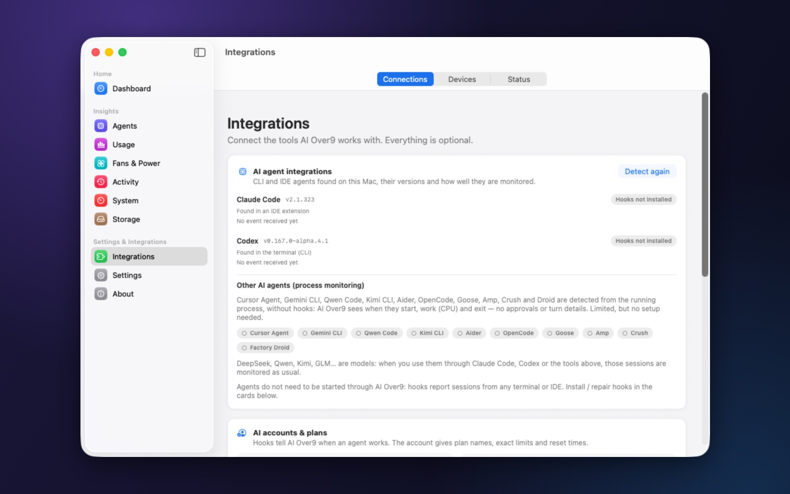
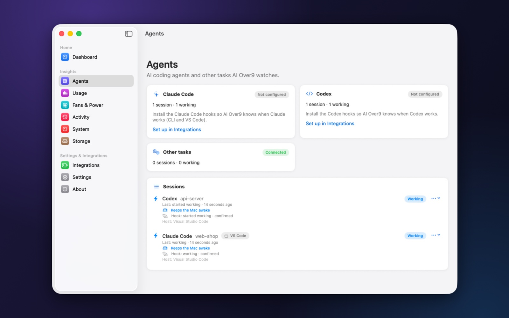

# Connecting Claude Code and Codex

[🇻🇳 Vietnamese](connect-agents.vi.md) · [← Back to the README](../README.md)

AI Over9 learns what your agents do from their **hooks**: small entries in the agents' own configuration that call
AI Over9's `aio-hook` command when something happens (a prompt starts, a tool runs, a turn ends…). `aio-hook` passes
the event to the app over a local socket in a few milliseconds and never blocks the agent.

- [How it works](#how-it-works)
- [Claude Code](#claude-code)
- [Codex](#codex)
- [Custom configuration folders](#custom-configuration-folders)
- [Other agents](#other-agents)
- [Windows and Linux](#windows-and-linux)
- [Checking that it works](#checking-that-it-works)
- [Troubleshooting](#troubleshooting)
- [Removing the hooks](#removing-the-hooks)

---

## How it works

| | Claude Code | Codex |
|---|---|---|
| Configuration file | `~/.claude/settings.json` | `~/.codex/hooks.json` |
| Events | `SessionStart`, `UserPromptSubmit`, `PreToolUse`, `PostToolUse`, `Stop`, `StopFailure`, `Notification`, `PermissionRequest`, `SessionEnd` | `SessionStart`, `UserPromptSubmit`, `PreToolUse`, `PostToolUse`, `PermissionRequest`, `Stop`, `Interrupt`, `SessionEnd` |
| Where it works | terminal, VS Code, Claude desktop app | CLI, VS Code extension, ChatGPT app |
| Extra step | — | trust the hooks in Codex once |

**Rules AI Over9 follows when it edits these files:**

- you see a preview of every change before it is written;
- the file is **backed up** first, then **merged** — your own hooks and settings stay as they are;
- only AI Over9's own entries (`aio-hook`) are ever added, moved or removed;
- if the file is not valid JSON, nothing is written.

Agents do not need to be started through AI Over9: hooks report sessions from any terminal or editor.

---

## Claude Code

1. Open **Integrations**. AI Over9 lists the agents it found and their versions.

   

2. Open the **Claude Code** card › **Preview install** › check the list of changes › **Apply**.
3. Give Claude Code a prompt. Within a second the session appears in **Agents** as *Working*.

   

**Which Claude Code?** All of them — the hooks are in your user settings, so the terminal (`claude`), the VS Code
extension and the Claude desktop app all report.

**Messages into an open session** (with *Dangerous actions* on) use Claude Code's session inbox: they arrive at once,
even mid-turn. See the [Telegram guide](telegram.md#chatting-with-your-agents).

---

## Codex

### 1. Install the hooks

In **Integrations › Codex**:

- **Codex hooks (recommended)** › **Preview install** › **Apply** — writes `~/.codex/hooks.json`;
- **Codex notify (fallback)** is only for old Codex versions without hooks: it reports finished turns, nothing else.

### 2. Trust them in Codex (once)

Codex runs a hook only **after you approved it**. Until then it skips it silently: no status, no messages, and
AI Over9 cannot tell why from the outside — except by reading Codex's approval list, which it does.

- The Codex card says **"Codex has not trusted AI Over9's hooks"** and offers **Review in Terminal…**. It opens
  Terminal with Codex, which shows **Hooks need review**.
- Choose **Review hooks**. Check that each one runs `aio-hook --agent codex`, then **Trust all and continue**.
- Quit Codex (Ctrl+C twice).
- No button, or Codex does not show the screen? Start Codex in a terminal and type `/hooks`.

Codex keeps the approval in `~/.codex/config.toml` (`[hooks.state.…] trusted_hash`). AI Over9 only **reads** it — the
approval is always your decision in Codex.

### 3. Restart Codex where you use it

Windows that were open before you trusted the hooks keep the old state:

- **VS Code:** *Command Palette › Developer: Reload Window*;
- **ChatGPT app:** quit it (⌘Q) and open it again;
- **terminal:** start a new `codex`.

> Codex asks again when a hook changes (for example after AI Over9 moves its hook command). If Codex sessions stop
> appearing, the Codex card shows it.

### Messages into an open Codex session

With *Dangerous actions* on, a message from Telegram reaches a Codex session like this:

- **open and idle** in VS Code or the ChatGPT app → that window starts the turn at once, through Codex's own
  window-to-window channel; it shows in the window like a typed message;
- **busy** → the message waits for the end of the current turn (the `Stop` hook hands it over);
- **not open anywhere** → `codex exec resume` continues it in the background; the answer comes back on Telegram.

---

## Custom configuration folders

If you moved an agent's folder with `CLAUDE_CONFIG_DIR` or `CODEX_HOME`, AI Over9 uses the variable automatically.
You can also pick the folder in the agent's card in **Integrations**; hooks, plan limits and token counts follow it.
After changing the folder, install the hooks again there.

---

## Other agents

Cursor Agent, Gemini CLI, Qwen Code, Kimi CLI, Aider, OpenCode, Goose, Amp, Crush and Factory Droid are recognised from
their running process — no setup. AI Over9 sees when they start, work (CPU) and exit, but not approvals, turns or
answers.

DeepSeek, Qwen, Kimi, GLM… are models: used through Claude Code, Codex or the tools above, those sessions are monitored
as usual.

---

## Windows and Linux

Same steps in the **Agents** page of the Windows / Linux app: **Connect** writes the same files (merged and backed up)
with the app's own command (`AIOver9.exe --hook …`). Codex needs the same one-time approval. With the Linux AppImage,
keep the file in one place; after moving it, use **Agents › Repair**.

---

## Checking that it works

- **Agents** lists the session with its state and *Last: … seconds ago*.
- **Integrations › AI agent integrations** shows *Last event* per agent.
- On Telegram, `/sessions` lists them.

---

## Troubleshooting

| Symptom | Cause and fix |
|---|---|
| Claude Code sessions never appear | Hooks not installed, or installed in another folder: Integrations › Claude Code › Preview install. If you use `CLAUDE_CONFIG_DIR`, pick that folder. |
| Codex sessions never appear | Hooks not trusted in Codex ([step 2](#2-trust-them-in-codex-once)), or Codex not restarted afterwards ([step 3](#3-restart-codex-where-you-use-it)). |
| A session stays *Working* after the agent finished | It may be running background tasks; it turns *finished* when the last one ends. A session silent for a long time becomes *unknown* and no longer keeps the computer awake. |
| Hooks point to another copy of the app | macOS re-points AI Over9's hooks by itself when the app starts. Windows / Linux show it in **Agents**: use *Repair*. With Codex, approve the changed hooks again. |
| The agent's file "is not valid JSON" | Fix the file by hand first; AI Over9 never writes into a file it cannot parse. |

---

## Removing the hooks

**Integrations › Claude Code / Codex › Preview removal › Apply.** Only AI Over9's entries are removed; a backup of the
previous file is kept in AI Over9's data folder.
