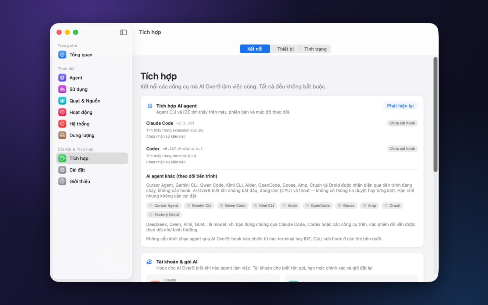
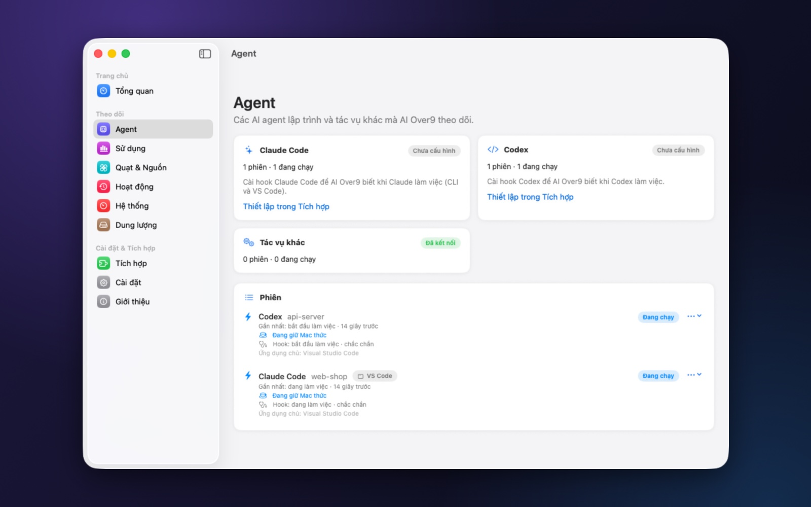

# Kết nối Claude Code và Codex

[🇬🇧 English](connect-agents.md) · [← Về README](../README_VI.md)

AI Over9 biết agent đang làm gì nhờ **hook**: vài dòng nhỏ trong cấu hình của chính agent, gọi lệnh `aio-hook` của
AI Over9 mỗi khi có sự kiện (bắt đầu prompt, chạy công cụ, xong một lượt…). `aio-hook` chuyển sự kiện cho app qua
socket cục bộ trong vài mili-giây và không bao giờ làm agent phải chờ.

- [Cách hoạt động](#cách-hoạt-động)
- [Claude Code](#claude-code)
- [Codex](#codex)
- [Thư mục cấu hình tuỳ chỉnh](#thư-mục-cấu-hình-tuỳ-chỉnh)
- [Agent khác](#agent-khác)
- [Windows và Linux](#windows-và-linux)
- [Kiểm tra đã chạy chưa](#kiểm-tra-đã-chạy-chưa)
- [Xử lý sự cố](#xử-lý-sự-cố)
- [Gỡ hook](#gỡ-hook)

---

## Cách hoạt động

| | Claude Code | Codex |
|---|---|---|
| File cấu hình | `~/.claude/settings.json` | `~/.codex/hooks.json` |
| Sự kiện | `SessionStart`, `UserPromptSubmit`, `PreToolUse`, `PostToolUse`, `Stop`, `StopFailure`, `Notification`, `PermissionRequest`, `SessionEnd` | `SessionStart`, `UserPromptSubmit`, `PreToolUse`, `PostToolUse`, `PermissionRequest`, `Stop`, `Interrupt`, `SessionEnd` |
| Chạy ở đâu | terminal, VS Code, app Claude desktop | CLI, extension VS Code, ChatGPT app |
| Bước thêm | — | duyệt hook trong Codex một lần |

**Nguyên tắc AI Over9 tuân theo khi sửa các file này:**

- bạn được xem trước mọi thay đổi trước khi ghi;
- file được **sao lưu** trước, rồi **gộp** — hook và cài đặt riêng của bạn giữ nguyên;
- chỉ thêm, di chuyển hoặc gỡ các dòng của AI Over9 (`aio-hook`);
- nếu file không phải JSON hợp lệ, không ghi gì cả.

Không cần mở agent thông qua AI Over9: hook báo phiên từ mọi terminal hay trình soạn thảo.

---

## Claude Code

1. Mở **Tích hợp**. AI Over9 liệt kê các agent tìm thấy và phiên bản.

   

2. Mở thẻ **Claude Code** › **Xem trước khi cài** › xem danh sách thay đổi › **Áp dụng**.
3. Gửi một prompt cho Claude Code. Chưa tới một giây sau, phiên hiện trong **Agent** với trạng thái *Đang làm*.

   

**Claude Code nào?** Tất cả — hook nằm trong cài đặt người dùng nên terminal (`claude`), extension VS Code và app Claude
desktop đều báo về.

**Nhắn vào phiên đang mở** (khi bật *Hành động nguy hiểm*) dùng hộp thư phiên của Claude Code: tin vào ngay, kể cả khi
agent đang làm dở. Xem [hướng dẫn Telegram](telegram.vi.md#chat-với-agent).

---

## Codex

### 1. Cài hook

Trong **Tích hợp › Codex**:

- **Codex hooks (khuyến nghị)** › **Xem trước khi cài** › **Áp dụng** — ghi `~/.codex/hooks.json`;
- **Codex notify (dự phòng)** chỉ dành cho Codex bản cũ chưa có hook: chỉ báo khi xong lượt, không gì khác.

### 2. Duyệt hook trong Codex (một lần)

Codex chỉ chạy hook **sau khi bạn duyệt**. Trước đó nó lặng lẽ bỏ qua: không trạng thái, không tin nhắn, và từ bên
ngoài không thể biết lý do — trừ khi đọc danh sách duyệt của Codex, và AI Over9 làm đúng việc đó.

- Thẻ Codex báo **"Codex chưa duyệt hook của AI Over9"** kèm nút **Duyệt trong Terminal…**. Nút mở Terminal chạy Codex,
  Codex hiện màn hình **Hooks need review**.
- Chọn **Review hooks**. Kiểm tra mỗi hook đều chạy `aio-hook --agent codex`, rồi **Trust all and continue**.
- Thoát Codex (Ctrl+C hai lần).
- Không có nút, hoặc Codex không hiện màn hình đó? Chạy Codex trong terminal và gõ `/hooks`.

Codex lưu việc duyệt trong `~/.codex/config.toml` (`[hooks.state.…] trusted_hash`). AI Over9 chỉ **đọc** — việc duyệt
luôn là quyết định của bạn trong Codex.

### 3. Khởi động lại Codex ở nơi bạn dùng

Các cửa sổ đã mở từ trước khi duyệt vẫn giữ trạng thái cũ:

- **VS Code:** *Command Palette › Developer: Reload Window*;
- **ChatGPT app:** thoát hẳn (⌘Q) rồi mở lại;
- **terminal:** chạy `codex` mới.

> Codex hỏi lại khi hook thay đổi (ví dụ sau khi AI Over9 đổi đường dẫn lệnh hook). Nếu phiên Codex không còn hiện,
> thẻ Codex sẽ báo.

### Nhắn vào phiên Codex đang mở

Khi bật *Hành động nguy hiểm*, tin từ Telegram tới phiên Codex như sau:

- **đang mở và rảnh** trong VS Code hoặc ChatGPT app → chính cửa sổ đó bắt đầu lượt mới ngay, qua kênh liên lạc giữa
  các cửa sổ của Codex; tin hiện trong cửa sổ như bạn tự gõ;
- **đang làm** → tin chờ tới cuối lượt hiện tại (hook `Stop` trao tin);
- **không mở ở đâu** → `codex exec resume` chạy tiếp ở nền; câu trả lời gửi về Telegram.

---

## Thư mục cấu hình tuỳ chỉnh

Nếu bạn đã chuyển thư mục của agent bằng `CLAUDE_CONFIG_DIR` hoặc `CODEX_HOME`, AI Over9 tự dùng biến đó. Bạn cũng có
thể chọn thư mục ngay trong thẻ của agent ở **Tích hợp**; hook, hạn mức và số token đi theo thư mục đó. Đổi thư mục
xong thì cài lại hook ở thư mục mới.

---

## Agent khác

Cursor Agent, Gemini CLI, Qwen Code, Kimi CLI, Aider, OpenCode, Goose, Amp, Crush và Factory Droid được nhận diện qua
tiến trình đang chạy — không cần cài đặt. AI Over9 biết khi chúng bắt đầu, đang làm (CPU) và thoát, nhưng không biết
việc chờ duyệt, từng lượt hay câu trả lời.

DeepSeek, Qwen, Kimi, GLM… là model: khi dùng qua Claude Code, Codex hoặc các công cụ trên, phiên vẫn được theo dõi
như bình thường.

---

## Windows và Linux

Các bước tương tự ở trang **Agents** của app Windows / Linux: **Connect** ghi đúng các file trên (gộp và sao lưu) với
lệnh riêng của app (`AIOver9.exe --hook …`). Codex cũng cần duyệt một lần. Với AppImage trên Linux, để file cố định một
chỗ; nếu di chuyển, dùng **Agents › Repair**.

---

## Kiểm tra đã chạy chưa

- **Agent** liệt kê phiên với trạng thái và *Lần cuối: … giây trước*.
- **Tích hợp › Tích hợp AI agent** hiện *sự kiện gần nhất* của từng agent.
- Trên Telegram, `/sessions` liệt kê các phiên.

---

## Xử lý sự cố

| Hiện tượng | Nguyên nhân và cách sửa |
|---|---|
| Phiên Claude Code không bao giờ hiện | Chưa cài hook, hoặc cài ở thư mục khác: Tích hợp › Claude Code › Xem trước khi cài. Nếu dùng `CLAUDE_CONFIG_DIR`, chọn đúng thư mục đó. |
| Phiên Codex không bao giờ hiện | Chưa duyệt hook trong Codex ([bước 2](#2-duyệt-hook-trong-codex-một-lần)), hoặc chưa khởi động lại Codex sau đó ([bước 3](#3-khởi-động-lại-codex-ở-nơi-bạn-dùng)). |
| Phiên vẫn *Đang làm* dù agent đã xong | Có thể còn tác vụ chạy nền; phiên chuyển *đã xong* khi tác vụ cuối kết thúc. Phiên im lặng quá lâu chuyển *không rõ* và không còn giữ máy thức. |
| Hook trỏ tới bản app khác | macOS tự trỏ lại hook của AI Over9 khi app khởi động. Windows / Linux báo ở **Agents**: dùng *Repair*. Với Codex, duyệt lại hook đã thay đổi. |
| File của agent "không phải JSON hợp lệ" | Sửa file bằng tay trước; AI Over9 không bao giờ ghi vào file nó không đọc được. |

---

## Gỡ hook

**Tích hợp › Claude Code / Codex › Xem trước khi gỡ › Áp dụng.** Chỉ các dòng của AI Over9 bị gỡ; bản sao lưu file cũ
được giữ trong thư mục dữ liệu của AI Over9.
