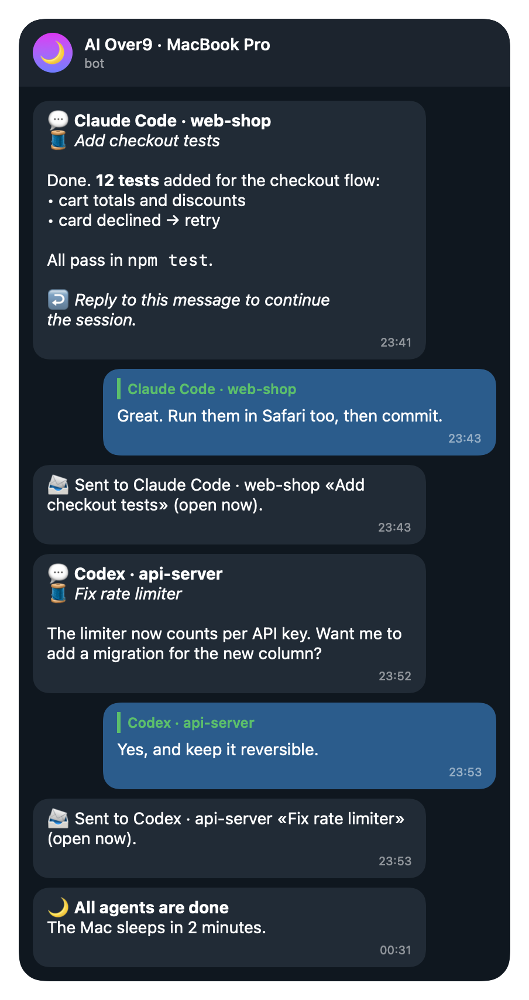
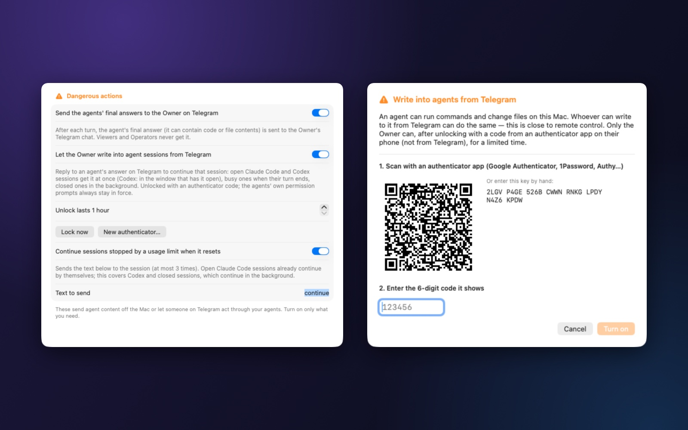

# Telegram guide

[🇻🇳 Vietnamese](telegram.vi.md) · [← Back to the README](../README.md)

Telegram is AI Over9's remote control: notifications from your agents, status and actions from anywhere, and — if
you turn it on — a chat with every agent session on your computer.

- [Create your bot and pair](#create-your-bot-and-pair)
- [People and roles](#people-and-roles)
- [Notifications](#notifications)
- [Commands](#commands)
- [Chatting with your agents](#chatting-with-your-agents)
- [Continue after a usage limit](#continue-after-a-usage-limit)
- [Security](#security)
- [Troubleshooting](#troubleshooting)



---

## Create your bot and pair

You use **your own bot** — one per computer. Nothing goes through a server of ours.

1. In Telegram, open [@BotFather](https://t.me/BotFather) and send `/newbot`. Choose a name and a username ending in
   `bot`. BotFather replies with a **token** like `123456789:AA…`.
2. In AI Over9: **Integrations › Telegram**. Paste the token and click **Save to Keychain**. The app checks it with
   Telegram and shows *Bot verified: @yourbot*.
   - The token is stored **only in the macOS Keychain** (Windows: Credential Manager; Linux: the system keyring).
   - Never paste it into a chat — not with the bot, not with an AI.
3. Click **Create pairing code (you become Owner)**. Open a private chat with your bot and send exactly what the app
   shows, for example `/pair 7AB6NS2B`. The code works once and expires after a few minutes.
4. The bot answers *Paired … as Owner*. Send `/help` to see what you can do.

---

## People and roles

Add family or teammates with **Create code for another person**, or approve someone who sends a pairing request.

| Role | Can |
|---|---|
| **Viewer** | read status, sessions, usage, why the computer is awake |
| **Operator** | everyday actions: keep awake, Finish then sleep, cancel, sleep (with checks), fans to Automatic, allowed automations |
| **Owner** | everything: users, power, fan speeds, shutdown (if enabled) — and **chatting with agents** |

Remove someone in the app or with `/users` and `/revoke` (Owner).

---

## Notifications

What arrives, and when (Settings › Notifications and Integrations › Telegram):

- an agent **started**, **finished a turn** (with the usage left), **failed** or was **interrupted**;
- an agent **needs your approval**;
- a usage **limit** is almost used, reached, or available again;
- *Finish, then sleep* countdown, sleep, the app quitting, the computer shutting down, the lid closed while agents work;
- fan and thermal safety (macOS).

**Only when I am away:** turn messages wait until you have left the computer for 2 minutes, so your phone stays quiet
while you work. Approvals and limits always come through.

Commands sent while the computer slept are not replayed one by one: you get a short summary instead. Project names can
be hidden (*Include project folder names in messages*).

---

## Commands

| Command | Role | What it does |
|---|---|---|
| `/status`, `/menu` | Viewer | Overview with buttons |
| `/why` | Viewer | Why the computer is awake, what still blocks sleep |
| `/agents`, `/sessions` | Viewer | Agents and sessions |
| `/usage`, `/reset` | Viewer | Plan limits, reset times, tokens |
| `/awake` · `/awake 30` · `/awake off` | Viewer · Operator | Status · keep awake 30 more minutes · stop |
| `/sleep`, `/cancel` | Operator | Sleep after checks and a countdown · cancel |
| `/fans`, `/fans auto`, `/fans cool` | Viewer · Operator | Fans (macOS) |
| `/fans set <1/2/all> <rpm>`, `/fans profile <name>` | Owner | Constant speed, profiles (if allowed) |
| `/mission`, `/missions`, `/report` | Viewer | Tonight's work |
| `/battery`, `/power`, `/profile <name>` | Viewer · Operator | Battery, power modes |
| `/schedule`, `/automation`, `/run <name>` | Viewer · Operator | Schedules, allowed automations |
| `/devices`, `/device <name> on/off` | Viewer · Operator | Smart devices |
| `/unlock <code>`, `/lock` | Owner | Open / close chatting with agents |
| `/new <folder> [claude/codex] <task>` | Owner | Start a new agent session in a folder inside the allowed parent |
| `/users`, `/revoke` | Owner | People |
| `/lang en` · `/lang vi`, `/help` | Viewer | Language, help |

Risky actions ask for a confirmation button; permissions are checked again when you press it. The bot never accepts a
shell command.

---

## Chatting with your agents

### Turn it on

**Settings › Dangerous actions** (off by default):

1. **Send the agents' final answers to the Owner on Telegram** — confirm.
2. **Let the Owner write into agent sessions from Telegram** — scan the QR code with an authenticator app (Google
   Authenticator, 1Password, Authy…), enter the 6-digit code, **Turn on**.
3. **Unlock lasts** 1 hour by default (up to 24). **Lock now** ends it; **New authenticator…** replaces the key.



### Answers

When an agent finishes a turn, its final answer is sent to the Owner:

```
💬 Claude Code · web-shop
🧵 Add checkout tests

Done. 12 tests added for the checkout flow …

↩️ Reply to this message to continue the session.
```

- the agent, the project and the **session title** (🧵) — so you always know which conversation it is;
- formatting kept: bold, italics, lists, links, code, code blocks, quotes; **tables** become aligned columns;
- very long answers are shortened, with a note; the full text stays in the session.

### Unlock

Writing needs an unlock with a code from your authenticator app: `/unlock 123456`. It lasts the time you chose, also
across restarts of the app. `/lock` closes it.

### Where your message goes

- **Reply to an answer** → that answer's session. The reliable way with several sessions.
- **A plain message** → the session you picked in `/sessions` (💬 #n or `/sessions n`), else the session of the
  latest answer you received.
- A reply to an answer the bot can no longer place is refused with a note — never sent to another session.

### What happens then

| Session | Your message | Bot says |
|---|---|---|
| Claude Code, open (terminal, VS Code, desktop) | delivered at once, even mid-turn; the agent starts its answer with `📱 Telegram: …` so the message also shows in the session window | 📨 Sent … (open now) |
| Codex, open and idle in VS Code / the ChatGPT app | that window starts the turn at once; shows there like a typed message | 📨 Sent … (open now) |
| Codex, busy | handed over at the end of the current turn | ⏳ … when its current turn ends |
| Closed session | continued in the background (`claude --resume` / `codex exec resume`); answer on Telegram; the session shows the turn when reopened | 🔄 … continues in the background |

If something cannot run (for example the agent's command-line tool is missing), the bot says why — a message is never
dropped silently.

### Quick chat — ask a light model (macOS)

**Settings › Quick chat**: choose a chat service (OpenAI, Anthropic, Gemini, OpenRouter, DeepSeek, Ollama on this computer,
or any OpenAI-compatible address), paste its API key (kept in the Keychain) and pick a model (**Load models** lists them).
Or use **your own plan**: *Claude Code* (your Claude plan, e.g. model `haiku`) or *Codex CLI* (your ChatGPT plan) — the
tool already signed in on this computer is asked in read-only mode; it counts in that plan's usage.

- `/ask <question>` starts a quick chat; plain messages (and voice messages) go there until you close it.
- `/ask done` turns the chat into a **task** (goal, what was agreed, done when) with buttons **Hand to <session>** —
  one press sends it into that session like a typed message; the agent plans the details. `/new <folder>
  [claude|codex]` without a task starts a new session with it.
- `/ask @model <question>` uses that model for this chat (e.g. `/ask @sonnet …`); `/ask models` shows your quick
  models as buttons (set them in Settings, or the service's own list).
- `/ask off` stops, `/ask reset` clears the conversation.
- Optional: **Send a short description of the project** — README, AGENTS.md / CLAUDE.md, file tree, recent commits
  and uncommitted changes of the session's project (about 20 KB at most; never `.env`, keys or certificates).
- Owner only, same unlock as writing to agents. Saves the agents' usage: quick questions run on the light model.

### Voice messages (macOS)

**Settings › Dangerous actions › Let the Owner send voice messages to agent sessions** (off by default, needs agent
chat). Turning it on downloads the speech model once (Whisper "small", about 190 MB, checked against its checksum).

- Hold the microphone in Telegram and speak your request — to a reply, or to the session you picked.
- The voice message is turned into text **on this computer**: the audio never leaves it and is deleted right away.
- The bot shows what it heard (`🎙️ Heard: «…»`), and the text goes to the session like a typed message.
- Up to 5 minutes per message. Spoken language: detected automatically, or fixed to Vietnamese or English.
- Same unlock as writing. The speech model can be deleted again in the same place.

### Photos and files

**Settings › Dangerous actions › Let the Owner send photos and files to agent sessions** (off by default, needs agent
chat). Then send a photo, a screenshot or a document — with your request as its caption, or none — exactly like a
message: as a reply to an answer, or to the session you picked.

- The file is saved in the session's project under `.aio-files/` (added to `.git/info/exclude`, so it never shows up
  in git; files older than 7 days are removed). Without a known project folder it goes to AI Over9's own folder.
- The agent receives your caption followed by the path of each file, and opens it with its own tools — Claude Code and
  Codex both read images.
- An album (several photos at once) arrives as one message. Up to 10 files, 20 MB each (Telegram's limit for bots).
- Same unlock as writing. AI Over9 never opens or runs the files; remember a file can carry instructions just like a
  message.

---

## Approving permission prompts

**Settings › Dangerous actions › Approve agents' permission prompts from Telegram** (needs agent chat).

- While nobody uses the computer (1–10 minutes, your choice), an agent's permission prompt — run a command, edit a
  file… — arrives with the agent, project, session title and the exact command, and **✅ Allow / ❌ Deny** buttons.
- Owner only, while unlocked. Pressing a button while locked asks for `/unlock` and offers the buttons again.
- No answer within about 14 minutes → nothing is approved; the agent asks on the computer as usual.
- At the computer, the agent's own prompt shows at once — Telegram is not asked.
- Works for Claude Code and Codex. AI Over9 sets a longer wait on its own permission hook entry; Codex then asks you
  to trust the changed hook once.

## Session buttons and new sessions

- `/sessions` numbers the sessions and adds buttons for the Owner on every Claude Code and Codex session, finished ones
  included (they continue in the background): **💬 Write to #n** sends your next messages, photos and files to that
  session (`/sessions n` does the same), **📄 Changes #n** shows the project's uncommitted changes
  (`git diff --stat`, read-only), **⏹ #n** stops the current turn of a Codex session open in a window (unlock needed).
  The chosen session is marked 👈 in the list.
- `/new <folder> [claude|codex] <task>` starts a new session in a folder **inside the parent folder** you chose in
  **Settings › Dangerous actions › Start new agent sessions from Telegram** (the switch asks for it when you turn it
  on). `/new web-shop add tests` runs in `<parent>/web-shop`, `apps/web-shop` works too, and a folder that does not
  exist yet is created. Never outside the parent: absolute paths, `~`, `..`, hidden folders and links leading out are
  refused. Owner only, while unlocked. The answer comes back here and the session appears in `/sessions`.

## Continue after a usage limit

Optional rule in **Settings › Dangerous actions**: a session stopped by a usage limit gets your text (default
`continue`) once the limit resets — at most 3 times per session: open sessions get it like any message, closed ones
continue in the background. Until the reset the computer stays awake, so *Finish, then sleep* waits for the session to
continue and finish instead of sleeping through the reset.

---

## Security

- **Owner only.** Viewers and Operators never receive answers and cannot write to agents.
- **Second factor.** Writing needs a code from your authenticator app, not from Telegram: a stolen Telegram account
  alone cannot drive your agents. Wrong codes are rate-limited (5 per 15 minutes). The code is never stored in the
  message history; the authenticator key lives only in the Keychain.
- **Nothing bypassed.** The agents' own permission rules apply to every turn. The bot never runs a command itself;
  background turns start the agent with fixed arguments and pass your text on its standard input.
- **Only your chat.** Answers go to the Owner's private chat with your own bot. Nothing is stored by AI Over9 beyond
  the message history on your computer.

---

## Troubleshooting

| Symptom | Fix |
|---|---|
| The bot does not answer | Integrations › Telegram: the status must be *connected*. A second app polling the same bot token causes *conflict*: one bot per computer. |
| `/unlock` again and again | The unlock period ended, `/lock` was sent, or the authenticator was changed. |
| "Wrong code" | Use the current code; check that the computer's clock is set automatically. |
| No 💬 answers | *Send the agents' final answers* is off, or the agent is not connected ([connect agents](connect-agents.md)). |
| Codex: "⏳ when its current turn ends" | The session is busy — wait, or check that it is not open in a Codex window that does not respond. |
| Old commands after waking up | Commands older than 2 minutes are summarised, not run. |
