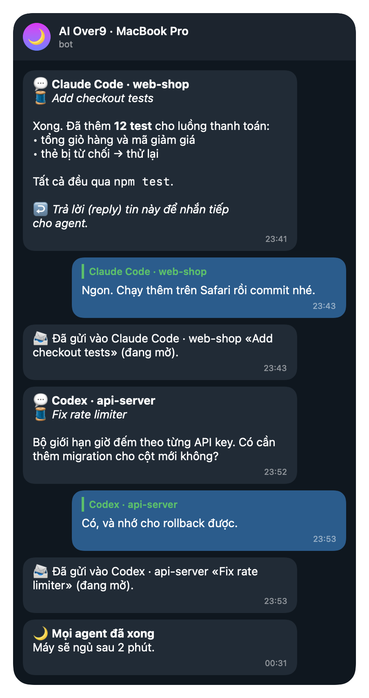
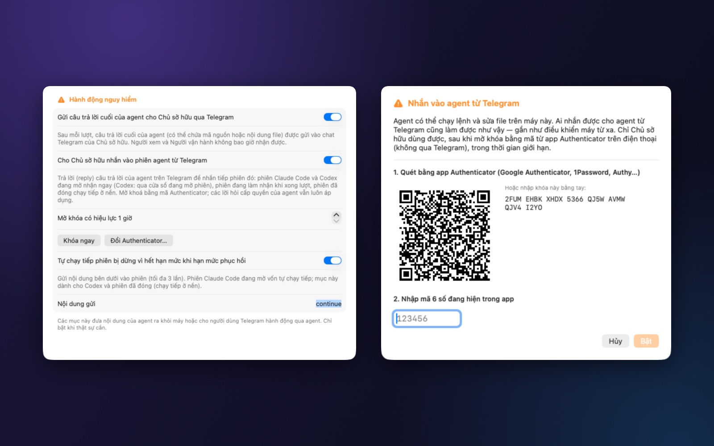

# Hướng dẫn Telegram

[🇬🇧 English](telegram.md) · [← Về README](../README_VI.md)

Telegram là bộ điều khiển từ xa của AI Over9: thông báo từ các agent, xem trạng thái và thao tác từ bất cứ đâu, và —
nếu bạn bật — chat với từng phiên agent trên máy.

- [Tạo bot và ghép nối](#tạo-bot-và-ghép-nối)
- [Người dùng và vai trò](#người-dùng-và-vai-trò)
- [Thông báo](#thông-báo)
- [Lệnh](#lệnh)
- [Chat với agent](#chat-với-agent)
- [Tiếp tục khi hết hạn mức](#tiếp-tục-khi-hết-hạn-mức)
- [Bảo mật](#bảo-mật)
- [Xử lý sự cố](#xử-lý-sự-cố)



---

## Tạo bot và ghép nối

Bạn dùng **bot của riêng mình** — mỗi máy một bot. Không có gì đi qua máy chủ của chúng tôi.

1. Trên Telegram, mở [@BotFather](https://t.me/BotFather) và gửi `/newbot`. Đặt tên và username kết thúc bằng `bot`.
   BotFather trả về một **token** dạng `123456789:AA…`.
2. Trong AI Over9: **Tích hợp › Telegram**. Dán token và bấm **Lưu vào Keychain**. App kiểm tra với Telegram và hiện
   *Đã xác minh bot: @botcuaban*.
   - Token chỉ nằm trong **Keychain của macOS** (Windows: Credential Manager; Linux: keyring của hệ thống).
   - Đừng bao giờ dán token vào cuộc chat nào — kể cả với bot hay với AI.
3. Bấm **Tạo mã ghép nối (bạn là Chủ sở hữu)**. Mở chat riêng với bot và gửi đúng nội dung app hiển thị, ví dụ
   `/pair 7AB6NS2B`. Mã chỉ dùng một lần và hết hạn sau vài phút.
4. Bot trả lời *Đã ghép nối … với vai trò Chủ sở hữu*. Gửi `/help` để xem bạn làm được gì.

---

## Người dùng và vai trò

Thêm người nhà hay đồng đội bằng **Tạo mã cho người khác**, hoặc duyệt người gửi yêu cầu ghép nối.

| Vai trò | Được làm |
|---|---|
| **Người xem** | xem trạng thái, phiên, hạn mức, vì sao máy đang thức |
| **Người vận hành** | thao tác thường ngày: giữ thức, Xong việc rồi ngủ, huỷ, cho ngủ (có kiểm tra), quạt về Tự động, tự động hoá được phép |
| **Chủ sở hữu** | mọi thứ: người dùng, nguồn, tốc độ quạt, tắt máy (nếu cho phép) — và **chat với agent** |

Gỡ người dùng trong app hoặc bằng `/users` và `/revoke` (Chủ sở hữu).

---

## Thông báo

Những gì được gửi, và khi nào (Cài đặt › Thông báo và Tích hợp › Telegram):

- agent **bắt đầu**, **xong một lượt** (kèm hạn mức còn lại), **lỗi** hoặc **bị ngắt**;
- agent **cần bạn duyệt**;
- **hạn mức** sắp hết, đã hết, hoặc đã phục hồi;
- đếm ngược *Xong việc rồi ngủ*, máy ngủ, app thoát, máy tắt, gập máy khi agent còn làm việc;
- an toàn quạt và nhiệt độ (macOS).

**Chỉ khi tôi vắng mặt:** tin về từng lượt chờ tới khi bạn rời máy 2 phút, để điện thoại yên lặng lúc bạn đang làm
việc. Tin cần duyệt và hạn mức luôn được gửi.

Lệnh gửi trong lúc máy ngủ không bị chạy lại từng cái: bạn nhận một tin tóm tắt. Có thể ẩn tên dự án (*Hiển thị tên
thư mục dự án trong tin nhắn*).

---

## Lệnh

| Lệnh | Vai trò | Tác dụng |
|---|---|---|
| `/status`, `/menu` | Người xem | Tổng quan kèm nút bấm |
| `/why` | Người xem | Vì sao máy đang thức, còn gì chặn máy ngủ |
| `/agents`, `/sessions` | Người xem | Agent và các phiên |
| `/usage`, `/reset` | Người xem | Hạn mức gói, giờ làm mới, token |
| `/awake` · `/awake 30` · `/awake off` | Người xem · Vận hành | Trạng thái · giữ thức thêm 30 phút · tắt |
| `/sleep`, `/cancel` | Vận hành | Cho ngủ sau khi kiểm tra và đếm ngược · huỷ |
| `/fans`, `/fans auto`, `/fans cool` | Người xem · Vận hành | Quạt (macOS) |
| `/fans set <1/2/all> <rpm>`, `/fans profile <tên>` | Chủ sở hữu | Tốc độ cố định, cấu hình (nếu cho phép) |
| `/mission`, `/missions`, `/report` | Người xem | Công việc đêm nay |
| `/battery`, `/power`, `/profile <tên>` | Người xem · Vận hành | Pin, chế độ nguồn |
| `/schedule`, `/automation`, `/run <tên>` | Người xem · Vận hành | Lịch, tự động hoá được phép |
| `/devices`, `/device <tên> on/off` | Người xem · Vận hành | Thiết bị thông minh |
| `/unlock <mã>`, `/lock` | Chủ sở hữu | Mở / khoá chat với agent |
| `/new <thư mục> [claude/codex] <việc>` | Chủ sở hữu | Mở phiên agent mới trong thư mục nằm trong thư mục cha được phép |
| `/users`, `/revoke` | Chủ sở hữu | Người dùng |
| `/lang en` · `/lang vi`, `/help` | Người xem | Ngôn ngữ, trợ giúp |

Thao tác rủi ro cần bấm nút xác nhận; quyền được kiểm tra lại khi bấm. Bot không bao giờ nhận lệnh shell.

---

## Chat với agent

### Bật tính năng

**Cài đặt › Hành động nguy hiểm** (mặc định tắt):

1. **Gửi câu trả lời cuối của agent cho Chủ sở hữu qua Telegram** — xác nhận.
2. **Cho Chủ sở hữu nhắn vào phiên agent từ Telegram** — quét mã QR bằng app Authenticator (Google Authenticator,
   1Password, Authy…), nhập mã 6 số, **Bật**.
3. **Mở khoá có hiệu lực** 1 giờ theo mặc định (tối đa 24 giờ). **Khoá ngay** để khoá; **Đổi Authenticator…** để thay khoá mới.



### Câu trả lời

Khi agent xong một lượt, câu trả lời cuối được gửi cho Chủ sở hữu:

```
💬 Claude Code · web-shop
🧵 Add checkout tests

Xong. Đã thêm 12 test cho luồng thanh toán …

↩️ Trả lời (reply) tin này để nhắn tiếp cho agent.
```

- agent, dự án và **tiêu đề phiên** (🧵) — luôn biết đang nói chuyện với phiên nào;
- giữ định dạng: chữ đậm, nghiêng, danh sách, link, code, khối code, trích dẫn; **bảng** hiển thị thành các cột thẳng
  hàng;
- câu trả lời quá dài được rút gọn, có ghi chú; bản đầy đủ vẫn nằm trong phiên.

### Mở khoá

Muốn nhắn phải mở khoá bằng mã từ app Authenticator: `/unlock 123456`. Hiệu lực trong thời gian bạn chọn, kể cả khi app
khởi động lại. `/lock` để khoá.

### Tin của bạn đi đâu

- **Reply một câu trả lời** → vào phiên của câu trả lời đó. Cách chắc chắn nhất khi có nhiều phiên.
- **Nhắn thường** → vào phiên bạn đã chọn trong `/sessions` (💬 #n hoặc `/sessions n`), nếu chưa chọn thì vào phiên của
  câu trả lời gần nhất bạn nhận được.
- Reply một câu trả lời bot không còn tra được thì bị từ chối kèm lời giải thích — không bao giờ gửi sang phiên khác.

### Sau đó điều gì xảy ra

| Phiên | Tin của bạn | Bot báo |
|---|---|---|
| Claude Code đang mở (terminal, VS Code, desktop) | vào ngay, kể cả khi đang làm dở; agent mở đầu câu trả lời bằng `📱 Telegram: …` nên tin cũng hiện trong cửa sổ phiên | 📨 Đã gửi … (đang mở) |
| Codex đang mở và rảnh trong VS Code / ChatGPT app | chính cửa sổ đó bắt đầu lượt mới ngay; hiện như tin bạn tự gõ | 📨 Đã gửi … (đang mở) |
| Codex đang làm | được đưa vào khi xong lượt hiện tại | ⏳ … khi xong lượt hiện tại |
| Phiên đã đóng | chạy tiếp ở nền (`claude --resume` / `codex exec resume`); câu trả lời về Telegram; mở lại phiên là thấy lượt đó | 🔄 … chạy tiếp ở nền |

Nếu có gì không chạy được (ví dụ thiếu công cụ dòng lệnh của agent), bot nói rõ lý do — tin không bao giờ bị bỏ qua
trong im lặng.

### Ảnh và file

**Cài đặt › Hành động nguy hiểm › Cho Chủ sở hữu gửi ảnh và file vào phiên agent** (mặc định tắt, cần bật chat với
agent). Sau đó gửi ảnh, ảnh chụp màn hình hay tài liệu — kèm yêu cầu ở phần chú thích, hoặc không — giống hệt một tin
nhắn: reply một câu trả lời, hoặc gửi vào phiên bạn đã chọn.

- File được lưu trong dự án của phiên, ở `.aio-files/` (được thêm vào `.git/info/exclude` nên không lẫn vào git; file
  quá 7 ngày tự xoá). Nếu không biết thư mục dự án thì lưu trong thư mục riêng của AI Over9.
- Agent nhận chú thích của bạn kèm đường dẫn từng file, rồi tự mở bằng công cụ của nó — Claude Code và Codex đều đọc
  được ảnh.
- Album (nhiều ảnh cùng lúc) được gộp thành một tin. Tối đa 10 file, mỗi file 20 MB (giới hạn của Telegram cho bot).
- Dùng chung lần mở khoá với nhắn tin. AI Over9 không bao giờ tự mở hay chạy file; lưu ý file cũng có thể chứa chỉ dẫn
  như một tin nhắn.

---

## Duyệt yêu cầu cấp quyền

**Cài đặt › Hành động nguy hiểm › Duyệt yêu cầu cấp quyền của agent từ Telegram** (cần bật chat với agent).

- Khi không ai dùng máy (1–10 phút, tuỳ bạn chọn), yêu cầu cấp quyền của agent — chạy lệnh, sửa file… — được gửi kèm
  agent, dự án, tiêu đề phiên và đúng câu lệnh, cùng nút **✅ Cho phép / ❌ Từ chối**.
- Chỉ Chủ sở hữu, khi đang mở khoá. Bấm nút lúc đang khoá thì bot yêu cầu `/unlock` rồi gửi lại nút.
- Không có trả lời trong khoảng 14 phút → không cho phép gì; agent hỏi trên máy như thường.
- Đang ngồi máy thì hộp thoại của agent hiện ngay — không hỏi qua Telegram.
- Dùng được cho Claude Code và Codex. AI Over9 tăng thời gian chờ cho mục hook duyệt quyền của chính nó; Codex sẽ hỏi
  bạn duyệt lại hook đã đổi một lần.

## Nút theo phiên và mở phiên mới

- `/sessions` đánh số các phiên và thêm nút cho Chủ sở hữu ở mọi phiên Claude Code và Codex, kể cả phiên đã xong (sẽ
  chạy tiếp ở nền): **💬 Nhắn #n** chọn phiên nhận tin, ảnh và file tiếp theo (gõ `/sessions n` cũng được),
  **📄 Thay đổi #n** xem thay đổi chưa commit của dự án (`git diff --stat`, chỉ đọc), **⏹ #n** dừng lượt hiện tại của
  phiên Codex đang mở trong cửa sổ (cần mở khoá). Phiên đang chọn được đánh dấu 👈 trong danh sách.
- `/new <thư mục> [claude|codex] <việc cần làm>` mở phiên mới trong một thư mục **nằm trong thư mục cha** bạn chọn ở
  **Cài đặt › Hành động nguy hiểm › Mở phiên agent mới từ Telegram** (bật công tắc là app hỏi chọn). `/new web-shop thêm
  test` chạy trong `<thư mục cha>/web-shop`, `apps/web-shop` cũng được, thư mục chưa có thì được tạo mới. Không bao giờ
  ra ngoài thư mục cha: đường dẫn tuyệt đối, `~`, `..`, thư mục ẩn và liên kết trỏ ra ngoài đều bị từ chối. Chỉ Chủ sở
  hữu, khi đang mở khoá. Câu trả lời gửi về đây và phiên hiện trong `/sessions`.

## Tiếp tục khi hết hạn mức

Quy tắc tuỳ chọn trong **Cài đặt › Hành động nguy hiểm**: phiên bị dừng vì hết hạn mức sẽ nhận đoạn chữ của bạn (mặc
định `continue`) khi hạn mức được làm mới — tối đa 3 lần mỗi phiên: phiên đang mở nhận như một tin bình thường, phiên đã
đóng chạy tiếp ở nền. Tới giờ phục hồi máy được giữ thức, nên *Xong việc rồi ngủ* sẽ chờ phiên chạy tiếp và làm xong thay
vì ngủ quên qua giờ phục hồi.

---

## Bảo mật

- **Chỉ Chủ sở hữu.** Người xem và Người vận hành không bao giờ nhận câu trả lời và không nhắn được cho agent.
- **Lớp xác thực thứ hai.** Muốn nhắn cần mã từ app Authenticator, không phải từ Telegram: chỉ chiếm được tài khoản
  Telegram thì vẫn không điều khiển được agent. Nhập sai bị giới hạn (5 lần mỗi 15 phút). Mã không bao giờ được lưu
  trong lịch sử tin nhắn; khoá Authenticator chỉ nằm trong Keychain.
- **Không bỏ qua bước nào.** Quy tắc cấp quyền của agent áp dụng cho mọi lượt. Bot không bao giờ tự chạy lệnh; lượt chạy
  nền khởi động agent với tham số cố định và đưa nội dung tin qua đầu vào chuẩn (stdin).
- **Chỉ chat của bạn.** Câu trả lời chỉ tới chat riêng của Chủ sở hữu với bot của chính bạn. AI Over9 không lưu gì
  ngoài lịch sử tin nhắn trên máy bạn.

---

## Xử lý sự cố

| Hiện tượng | Cách sửa |
|---|---|
| Bot không trả lời | Tích hợp › Telegram: trạng thái phải là *đã kết nối*. Hai app cùng dùng một token bot sẽ báo *xung đột*: mỗi máy một bot. |
| Cứ phải `/unlock` | Hết thời gian mở khoá, đã gửi `/lock`, hoặc đã đổi Authenticator. |
| "Sai mã" | Dùng mã hiện tại; kiểm tra đồng hồ máy đang chỉnh giờ tự động. |
| Không có câu trả lời 💬 | Chưa bật *Gửi câu trả lời cuối của agent*, hoặc agent chưa kết nối ([kết nối agent](connect-agents.vi.md)). |
| Codex: "⏳ khi xong lượt hiện tại" | Phiên đang làm — chờ, hoặc kiểm tra phiên không bị mở ở một cửa sổ Codex không phản hồi. |
| Lệnh cũ sau khi máy thức dậy | Lệnh cũ hơn 2 phút được tóm tắt, không chạy. |
